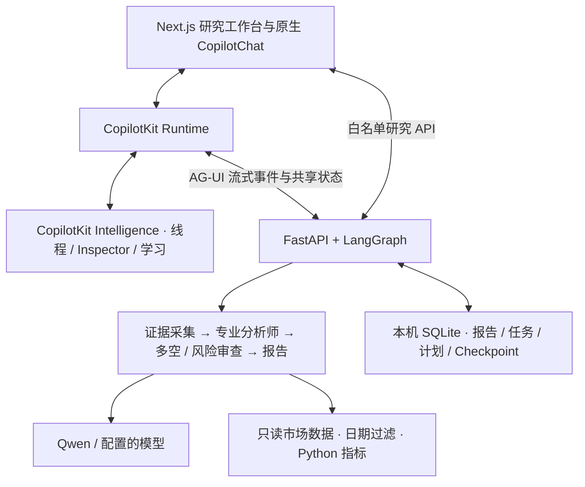

# Aperture · Finance Research Agent

基于 **CopilotKit + Next.js + LangGraph / FastAPI + Qwen** 的金融研究工作台。把研究配置、执行过程、报告、来源证据和后续问答接在同一条工作流里。

主应用位于 [copilotkit-app](copilotkit-app/)。仓库根目录不再保留旧工作台或手工前端。

当前版本：**v0.1.1**。面向单用户本机运行，市场数据与模型使用自己的授权；当前没有部署公网服务。

## 可以做什么

| 场景 | 当前能力 |
| --- | --- |
| 自由对话 | 原生 CopilotKit 聊天、流式回答、工具卡、模型返回的推理内容、上下文动态追问。建议点击后填入输入框，由用户发送。 |
| 单股研究 | 自选证券、市场和截止日期；六类分析师可选，支持快速、标准、深度研究，多空审查、风险审查与任务进度。可同时提交多个任务。 |
| 报告与证据 | 报告库检索、状态筛选、分钟级生成时间、报告问答、证据引用回链，以及 Markdown / JSON / 中文 PDF 导出。 |
| 研究对照 | 同股跨日期回看；同市场、同截止日的双标的横向对照（沪深可互比）。价格按共同成交日对齐，支持 5/20/60 日窗口、首日设为 100 的曲线和逐日数值；各份报告的证据独立绑定。 |
| A 股收盘复盘 | 同交易日样本、相对基准变化、量能、涨停/炸板/跌停、连板梯队、昨涨停股次日表现及近五日行业样本走势。 |
| 候选与条件核对 | 候选池、备注、观察历史与报告回链；按价格变化、相对基准和量比条件逐项核对样本，保存下一交易日复核条件。 |
| 定时任务 | 市场晨报、主题要闻、自选异动、公告追踪、周复盘与单股研究。支持预设草稿、启停、立即运行、独立历史、删除和批量操作。 |
| 数据与 AI 设置 | Qwen / 兼容模型配置、只读数据源设置、本机 SQLite 持久化、黑灰深色与清新白色主题、手机布局。 |

保留 **CopilotChat、原生工具渲染、Generative UI、AG-UI Streams、Shared State、Frontend Tools、Human in the Loop、Inspector 和 CopilotKit Intelligence 学习接入**。通用原生能力示例保留在 `/playground`。Automatic Learning 是技能提炼和审核发布流程，不代表自动训练模型。

## 架构



模型负责解释和研究意见；技术指标、条件核对、调度和双报告价格对齐由代码计算。报告对照仅读取保存的报告，不重新调用模型或补取最新行情。

## 快速开始

需要 Node.js 20.19+、Python 3.12+、[uv](https://docs.astral.sh/uv/getting-started/installation/) 和已授权的 [Longbridge CLI](https://open.longbridge.com)。

```powershell
git clone git@github.com:A1f1ed/Financial_Research_Agent.git
cd Financial_Research_Agent/copilotkit-app
# 新克隆时创建配置文件；已有 .env 时保留原配置
Copy-Item .env.example .env
npm ci
```

`npm ci` 会通过 uv 安装 Python 依赖。在项目目录 `.env` 中填写服务端配置：

```dotenv
AGENT_URL=http://127.0.0.1:8123
DASHSCOPE_API_KEY=<your-dashscope-key>
DASHSCOPE_BASE_URL=https://dashscope.aliyuncs.com/compatible-mode/v1
COPILOTKIT_AGENT_MODEL=openai:qwen3.8-max
QWEN_ENABLE_THINKING=true
CPK_INTELLIGENCE_LEARNING_CONTAINER_ID=copilotkit-tasks
```

原生线程、托管追踪和学习功能还需配置自己的 CopilotKit Intelligence：`CPK_INTELLIGENCE_API_KEY`、`INTELLIGENCE_API_URL`、`INTELLIGENCE_GATEWAY_WS_URL`。新增或修改线程开关配置后重新构建前端。密钥仅由服务端读取，不使用 `NEXT_PUBLIC_` 保存密钥。

```powershell
# 使用自己的 Longbridge 授权
longbridge auth login
# 正式运行：同时启动 Next.js 与 FastAPI
npm run build
npm run start:all
```

打开 [http://localhost:3000](http://localhost:3000)。FastAPI 默认监听 `127.0.0.1:8123`。开发模式使用 `npm run dev`。

生产构建使用 Webpack，启动器补齐 Next.js standalone 静态文件并读取项目目录 `.env`。新克隆需自己安装 uv；工作区已有的 `.tools` 不随仓库发布。可通过 `LONGBRIDGE_CLI_PATH` 指定 CLI 路径，通过 `RESEARCH_DATA_DIR` 指定持久化数据目录。

## 一条完整的研究路径

1. 在「单股分析」选择证券、截止日期、研究问题、深度与分析师，点击开始研究。
2. 查看执行阶段和工具过程；运行或部分失败的结果会按任务保存。
3. 在报告中点击 `[S编号]`，回到这份报告对应的来源，核对发布时间和数据缺口。
4. 就当前报告问答，或从报告库选择两份记录对照；双标的需同市场和同截止日。
5. 对沪深样本保存观察或验证条件，下一交易日收盘后复核；把自己的候选填入复盘或定时计划。
6. 定时任务预设只填写草稿，点击创建后才保存；可先「立即运行」查看产出。

计划调度和条件自动核对依赖 FastAPI 持续运行，程序关闭期间不会执行任务。任务中心的任务记录、定时计划和报告库分别管理；移除任务不会自动删除报告。

## 数据、持久化与边界

- Longbridge 为主要数据源。沪深日线可降级到腾讯财经；A 股专属事件和行情池使用东方财富，并保留来源与日期。
- 发布时间或交易日晚于截止日、无可核验发布时间的文本会被排除。滚动新闻接口可能不覆盖很早的历史，接口无返回不等于历史上没有事件。
- 技术指标和对照曲线使用未复权日线。拆股、分红等公司行动可能造成跳变，展示的价格变化不等于总回报。
- 对照只采用双方共同覆盖且有成交的日期，不填补停牌、缺失或重复日期。覆盖不足时显示实际区间和缺口。
- 财报期末不等于披露日。缺少三表或估值输入时保留缺口，不凭空生成目标价。历史过滤不构成严格的 point-in-time 回测数据库。
- 报告及研究数据默认在 `agent/data/research.sqlite3`，LangGraph checkpoint 在 `agent/data/checkpoints.sqlite3`；原生线程事件由已连接的 Intelligence 保存。应备份自己的数据目录。
- 当前是单用户本机版，尚无公网 SaaS 的身份认证、租户隔离、计费和生产运维体系。只读数据命令不读取持仓、不下单。

已观察到的不足和后续验收要求见 [研究路线图](copilotkit-app/RESEARCH-ROADMAP.md)，其中包含模型对数据缺口描述仍需改进的问题。

## 项目结构

```text
copilotkit-app/
  src/app/                 Next.js 页面、CopilotKit Runtime 与研究 API 代理
  src/components/          研究配置、原生聊天集成、报告、复盘、任务与设置
  src/lib/                 研究类型、历史恢复和对照规则
  agent/main.py            FastAPI 入口与 LangGraph 生命周期
  agent/src/               数据、研究流程、调度、持久化及业务模块
  agent/tests/             Python 业务与边界测试
  scripts/                 启动、uv 适配与原生能力集成检查
  VALIDATION.md            按版本记录的实际验收
  RESEARCH-ROADMAP.md       体验缺口与迭代记录
```

## 验证

```powershell
npm run build
npx tsc --noEmit
cd agent
uv run python -m unittest discover -s tests -v
```

本版本 Python 测试 59 项；生产页面走查、数据样本、接口观测及未覆盖项见 [验收记录](copilotkit-app/VALIDATION.md)。`scripts/smoke.py` 会调用已配置模型，运行前应了解模型费用。

## 参考与许可

业务场景参考 [Vibe AStock](https://github.com/simonlin1212/vibe-astock) 与 [TradingAgents-astock](https://github.com/simonlin1212/TradingAgents-astock)，备用数据适配思路参考 [a-stock-data](https://github.com/simonlin1212/a-stock-data)。当前应用保留 CopilotKit 原生集成，具体能力以本仓库实现及验收记录为准。

许可见 [LICENSE](copilotkit-app/LICENSE)。模型和行情服务的授权与使用条款由各服务提供方决定。
