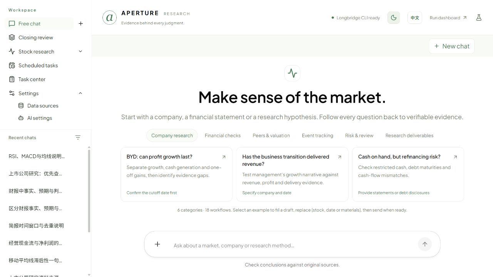
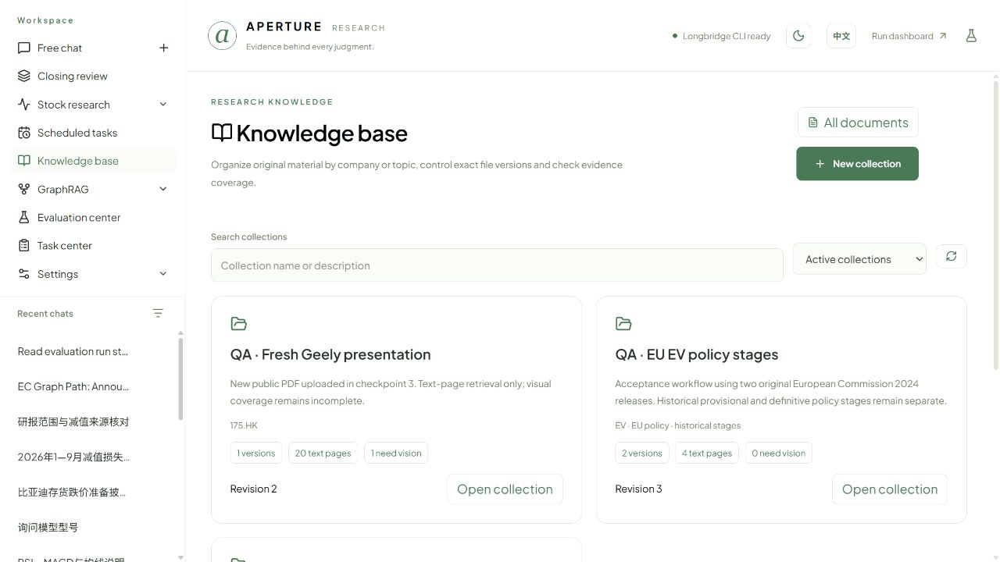
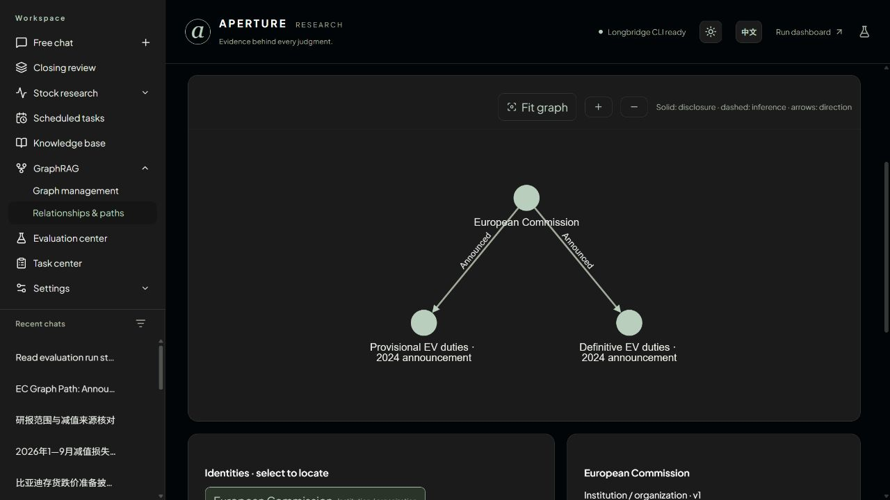
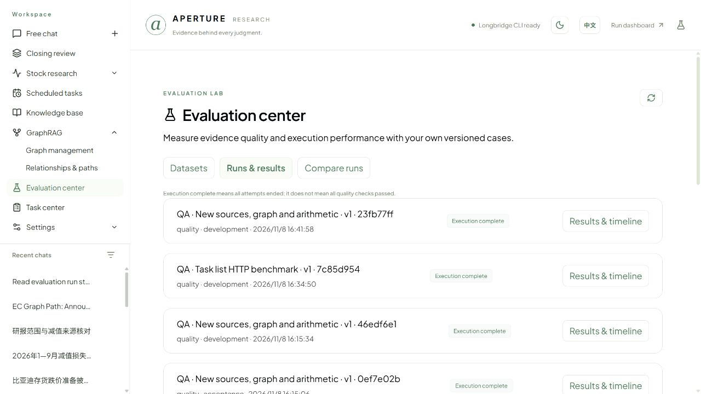
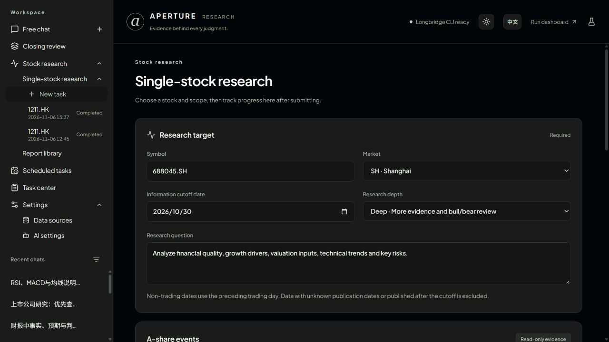
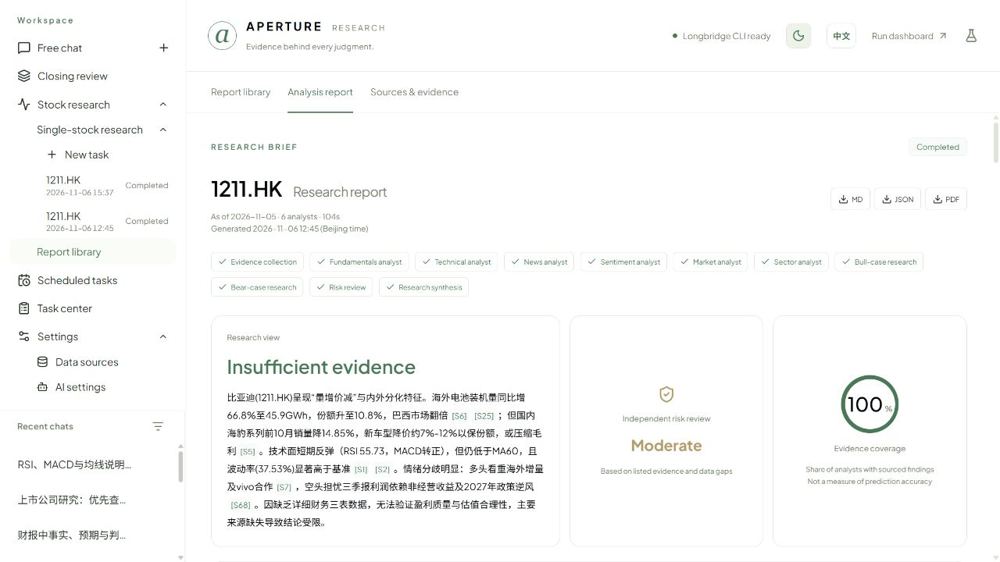
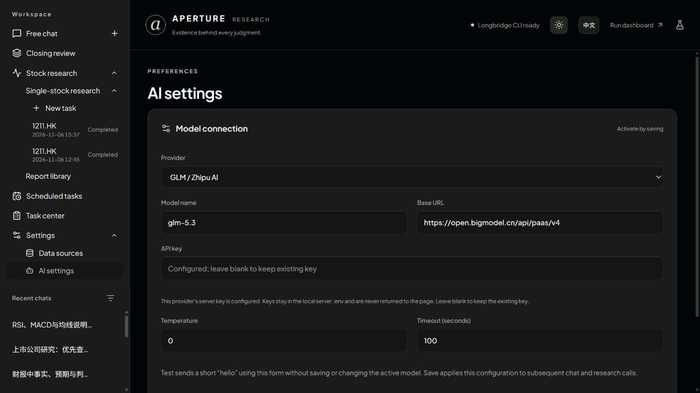
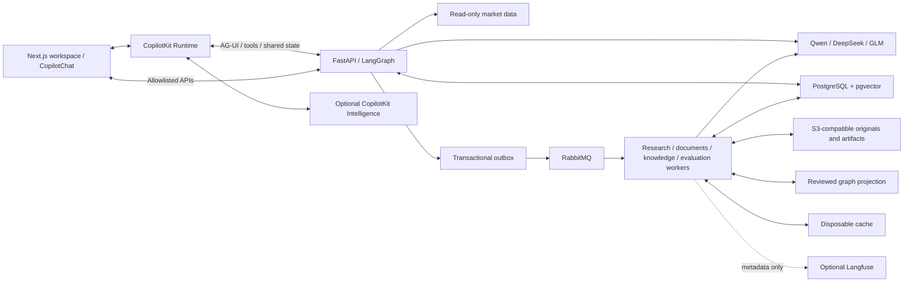

# Aperture · Finance Research Agent

**English** | [简体中文](README_zh-CN.md)

An evidence-first financial research workspace built with **CopilotKit, Next.js, LangGraph and FastAPI**.

Research companies, manage your source documents, explore reviewed relationships and measure the results. Aperture connects native streaming chat with an online knowledge base, cited RAG, GraphRAG and a versioned evaluation center. Bring your own Qwen, DeepSeek or GLM API connection.

[Interface previews](#interface-previews) · [Features](#features) · [Data](#data) · [Supported AI](#supported-ai) · [Quick start](#quick-start) · [Architecture](#architecture) · [Development](#development)

> Current scope: a single-user application running on your own machine. Public SaaS authentication, tenant isolation and billing are not implemented. The application performs read-only research; it does not place trades or access brokerage positions.

## Interface previews

Actual desktop captures from the running application. The interface defaults to English; **EN / 中文** beside the theme button switches languages. Both light and charcoal dark themes are available. Case names, source material and saved model outputs retain their original language.

### Native research chat



### Online knowledge management



### Reviewed GraphRAG and evidence paths



### Evaluation center



### Single-stock research and reports





### Multi-provider AI settings



The research/configuration/report/settings images include earlier workbench views; the knowledge, graph and evaluation captures document this delivery. Public-source QA records illustrate workflows, not independent financial accuracy or investment recommendations. No original PDF corpus or user database is bundled.

## Features

| Workflow               | What you can do                                                                                                                                                                                                                                                       |
| ---------------------- | --------------------------------------------------------------------------------------------------------------------------------------------------------------------------------------------------------------------------------------------------------------------- |
| Research chat          | Use native CopilotKit chat, streaming answers, expandable tool calls, provider-supplied reasoning and contextual follow-up questions. Explore 18 concrete finance workflow examples; selecting one fills a draft for you to edit and send.                            |
| Single-stock research  | Choose a symbol, market, information cutoff date, depth and analysts. Run multiple independent tasks. Select fundamentals, technicals, news, sentiment, market and sector analysts, with bull/bear and risk review options.                                           |
| Execution tracking     | Follow queue status, research stages and an estimated time remaining. Open the report or ask questions bound to that specific research. Estimates are approximate, not completion guarantees.                                                                         |
| Report library         | Search and filter saved research, inspect source IDs and publication times, ask report-specific questions, and export Markdown, JSON or PDF. Generation timestamps include minutes.                                                                                   |
| Report comparison      | Compare one stock across dates, or two stocks in the same market on the same cutoff date. Align saved prices on common trading sessions, with 5/20/60-session windows and a first-close index of 100. No new model run is needed.                                     |
| A-share closing review | Review a selected sample against a benchmark, volume ratios, limit-up/down and failed-breakout pools, streaks, next-day follow-through and recent industry distributions.                                                                                             |
| Candidates and checks  | Keep observations and notes, reuse candidates in reviews and schedules, and save measurable next-trading-day conditions. While the service runs, pending checks are evaluated after the target close when data is available.                                          |
| Scheduled research     | Draft market morning briefs, topic news roundups, watchlist move scans, filing trackers, weekly reviews or stock research. Presets fill forms; you create the schedule. Enable/disable, run now, inspect per-plan history, or delete records individually/in batches. |
| Online knowledge base | Upload PDF/images or import supported official links; manage collections, exact document versions, publication-date evidence, extraction coverage, index builds and archive/restore. No server-preloaded folder is required. |
| Cited document RAG | Keyword or pgvector hybrid retrieval under explicit document/date scope; native document Q&A, original PDF-page citations and exact-document binding for stock research. Missing dates and unreadable pages stay visible. |
| Reviewed financial arithmetic | Confirm original value, unit, period and basis, then compute with Decimal. Retain reviewed input revisions, formulas, conversions and calculation history. |
| GraphRAG | Extract relationship proposals from selected originals, verify entity identities, accept/reject/revoke with human review, publish to Neo4j, explore interactive paths and open supporting original pages. Historical snapshots preserve evidence. |
| Evaluation center | Create/import/edit datasets, publish immutable versions and run real queued retrieval, Agent, graph, calculation or list benchmarks. Inspect checks, failures, raw latency samples, budgets, cancellation, parent-linked retries and run comparisons. |
| AI and appearance      | Configure separate Qwen, DeepSeek and GLM profiles, test a greeting without saving, then save and activate. Switch English/Chinese and charcoal dark/fresh light themes. Responsive layouts support narrow screens.                                                   |

### Native CopilotKit, preserved

The workbench retains **CopilotChat, native tool cards, AG-UI streaming, Generative UI, Shared State, Frontend Tools and Human in the Loop**. It does not fabricate tool activity or reasoning logs.

Inspector, native thread history and the Intelligence learning integration use your configured **CopilotKit Intelligence** connection. Automatic Learning here means skill extraction and review/publishing, not automatic model training. Upstream integration demonstrations remain at `/playground`.

Optional **Langfuse** exports metadata-only research/tool/model traces through OpenTelemetry. Configure `LANGFUSE_PUBLIC_KEY`, `LANGFUSE_SECRET_KEY` and your regional `LANGFUSE_BASE_URL` in the server `.env`, then recreate services. Prompts, outputs, documents and reasoning are excluded; model token usage is recorded when available. Set `APERTURE_TRACING_ENABLED=false` to disable. This supplements Inspector; the [in-app evaluation center](docs/evaluations.md) now provides versioned datasets and actual background runs, with [measured acceptance evidence](docs/validation/checkpoint-3-completion.md).

### Knowledge-to-evidence workflow

1. **Knowledge base:** create a collection; upload an original or import a supported official link. Record a verified public release date and inspect text/visual coverage.
2. **RAG:** build a keyword or configured hybrid index; choose a historical cutoff, search evidence and open a native chat bound to exact document versions.
3. **GraphRAG:** use **Graph management** to extract proposals. Resolve identities and review evidence before publishing. Open **Relationships & paths** to query the reviewed graph.
4. **Evaluation center:** add your own cases and expected pages/values, publish a version, choose budgets and explicitly start a run. Compare saved runs after source, rule or configuration changes. Chat can read actual results and request a run through a human approval card.

Read the guides: [Document library and RAG](docs/document-library.md) · [Graph research](docs/graph-research.md) · [Evaluation center](docs/evaluations.md).

## Data

| Source                                        | Current use                                                                                                       | Coverage and limitations                                                                                                                                    |
| --------------------------------------------- | ----------------------------------------------------------------------------------------------------------------- | ----------------------------------------------------------------------------------------------------------------------------------------------------------- |
| [Longbridge CLI](https://open.longbridge.com/) | Primary prices, daily bars, financial data, news, company announcements, community samples and exchange calendars | Supports configured HK, US, Shanghai, Shenzhen and Singapore research. Availability depends on your account, permissions and the endpoint's history window. |
| Tencent Finance                               | Fallback unadjusted mainland daily bars                                                                           | Used when supported Longbridge historical data is unavailable; the source is recorded.                                                                      |
| Eastmoney public data                         | A-share events, trading disclosures, share unlocks, shareholder dealings and closing market pools                 | Records are checked against dates; issuer announcement links are retained where verified. Pool counts use the source's definitions.                         |
| Your documents | User-uploaded PDFs/images and supported official-source imports | Originals in S3-compatible storage; exact versions, publication evidence and derived text/index coverage retained. Cached public examples are not bundled or auto-loaded. |
| Local calculations                            | Moving averages, RSI/MACD, volatility, relative performance, condition checks and report price alignment          | Computed by code from retained data. Unadjusted prices can jump around corporate actions; price changes are not total investment returns.                   |

### Research boundaries

- Users choose the information cutoff. Later-dated or unverifiably dated evidence is excluded; a non-trading date uses the preceding available session.
- A reporting period's end is not its publication date. Missing statements or valuation inputs remain explicit gaps; they are not filled with invented numbers or price targets.
- A rolling news endpoint may not cover a distant historical date. An empty response does not establish that no event occurred.
- Comparison charts use common dates with trades. Suspensions, missing dates and duplicate records are not forward-filled.
- Historical filtering does **not** make this a complete point-in-time backtesting database. Evidence coverage is **not** model prediction accuracy.

## Supported AI

All three providers use OpenAI-compatible Chat Completions through the existing LangChain/OpenAI integration. Model names are editable: use a model available to your account.

| Provider                                                                                                  | Initial model choices                        | Base URL environment variable | API key environment variable |
| --------------------------------------------------------------------------------------------------------- | -------------------------------------------- | ----------------------------- | ---------------------------- |
| [DashScope Qwen](https://www.alibabacloud.com/help/en/model-studio/compatibility-of-openai-with-dashscope) | `qwen3.8-flash`, `qwen3.8-max`           | `DASHSCOPE_BASE_URL`        | `DASHSCOPE_API_KEY`        |
| [DeepSeek](https://api-docs.deepseek.com/)                                                                 | `deepseek-flash`, `deepseek-v4-pro`      | `DEEPSEEK_BASE_URL`         | `DEEPSEEK_API_KEY`         |
| [GLM / Zhipu AI](https://docs.bigmodel.cn/cn/guide/develop/openai/introduction)                            | `glm-5.3`, `glm-4.7`, `glm-4.7-FlashX` | `ZHIPU_BASE_URL`            | `ZHIPU_API_KEY`            |

In **Settings → AI settings**:

1. Select a provider. Each provider retains its own model, endpoint and generation settings. Existing `.env` base URLs and keys are used for fresh profiles.
2. Enter a model name, Base URL and optionally a replacement API key. A blank key keeps the configured key; saved keys are never sent back to the browser.
3. Select **Test connection**. It sends a short Chinese greeting using the current form, with no research tools, and shows success/reply/timing or a failure reason. It does not save or activate the draft. Tests wait at most 20 seconds.
4. Select **Save & activate** to apply the profile to subsequent chat, research and follow-up model calls. It does not restart a completed research task.

Keys entered in settings are written to server-only `APERTURE_ENV_FILE` (a shared private file in the application volume for containers; local `.env` for native development). Workers read saved replacements without a restart. Non-secret profiles live in PostgreSQL. GLM aliases `GLM_API_KEY`, `ZAI_API_KEY`, `ZHIPUAI_API_KEY`, `GLM_BASE_URL` and `ZAI_BASE_URL` are also recognized; `ZHIPU_*` takes precedence. Provider-specific reasoning differences are handled by the adapter; for example, GLM-5.3 requires reasoning and uses low effort for the greeting test.

A greeting verifies basic authentication and generation, not every model's tool-calling, structured output or research quality. API availability and account access can change.

## Quick start

### 1. Install prerequisites

- **Node.js 20.19+** and npm
- **Python 3.12+** and [uv](https://docs.astral.sh/uv/getting-started/installation/)
- **Docker Desktop with its Linux engine running** (the pinned development image currently targets amd64)
- An API key for at least one supported AI provider
- Your own [Longbridge](https://open.longbridge.com/) access, authorized inside the application container for market data

### 2. Clone and prepare the app

```powershell
git clone git@github.com:A1f1ed/Financial_Research_Agent.git
cd Financial_Research_Agent/copilotkit-app
# On a fresh clone only; keep an existing .env intact.
Copy-Item .env.example .env
npm ci
```

`npm ci` also installs the Python agent dependencies using uv. Use your own credentials; the repository does not include keys, databases or model caches.

### 3. Configure connections

You can enter the AI key in the settings page after starting, or populate the corresponding entries in `.env` beforehand:

```dotenv
DASHSCOPE_API_KEY=
DASHSCOPE_BASE_URL=https://dashscope.aliyuncs.com/compatible-mode/v1
DEEPSEEK_API_KEY=
DEEPSEEK_BASE_URL=https://api.deepseek.com/v1
ZHIPU_API_KEY=
ZHIPU_BASE_URL=https://open.bigmodel.cn/api/paas/v4

# Initial model until a profile is saved in settings:
COPILOTKIT_AGENT_MODEL=openai:qwen3.8-flash
```

For native thread history, hosted tracing and learning, configure your own `CPK_INTELLIGENCE_API_KEY`, `INTELLIGENCE_API_URL` and `INTELLIGENCE_GATEWAY_WS_URL`. Rebuild the UI after changing integration flags. Without Intelligence, local reports/tasks/checkpoints remain separate from native free-chat thread discovery.

Initialize local service credentials once, then build/start the API, independent workers, broker and database services:

```powershell
npm run infra:init
npm run services:up
docker compose --env-file ../infra/.env -f ../infra/compose.yaml --profile application exec api longbridge auth login
```

### 4. Build and run

```powershell
npm run build
npm run start:all
```

Open **[http://localhost:3000](http://localhost:3000)**. FastAPI listens on `127.0.0.1:8123`. Select your AI provider, test it, then save and activate before research. Development mode: `npm run dev`.

The production build uses Webpack. The launcher loads project `.env` and prepares Next.js standalone static assets. A one-shot migration service prepares PostgreSQL business and checkpoint schemas before API/workers start. Existing SQLite installations need the verified offline migration/cutover procedure in [infrastructure instructions](infra/README.md); starting a new database does not import old data automatically.

### 5. Follow a research through

1. Open **Stock research → Single-stock research**, set the target, cutoff, question and analyst scope, then start.
2. Follow execution progress. Each stock analysis is its own task; other tasks can run independently.
3. Read the report and select a `[S…]` citation to inspect the matching source.
4. Ask a question about that report or compare saved reports in the library.
5. Reuse candidates and conditions in a closing review or draft a schedule. Creating a schedule is always an explicit action.

Submitted research runs in independent Celery workers and survives API restart. Removing a task or schedule preserves its reports/history. Automatic schedules and checks are initially paused for migration safety; after verification, set `RESEARCH_SCHEDULER_ENABLED=true` in `infra/.env` and run `npm run services:up`. Manual **Run now** works while scheduling is paused. Keep workers, Beat and dispatcher running for automation; host sleep stops local execution.

## Architecture



| Layer | Technology and role |
| --- | --- |
| Frontend | Next.js 16, React 19, TypeScript, CopilotKit 1.79; Recharts and Cytoscape for charts/graphs |
| Agent/API | Python 3.12+, FastAPI, LangGraph, LangChain, OpenAI-compatible provider adapters |
| Durable state | PostgreSQL 17; pgvector; SQLAlchemy/psycopg; Alembic; PostgreSQL LangGraph checkpoints |
| Jobs and cache | Celery, RabbitMQ, transactional outbox and fenced leases; Redis TTL cache |
| Evidence and graph | S3 API (local SeaweedFS), PDF extraction/rendering, Neo4j reviewed projections |
| Observability and verification | Native CopilotKit Inspector, optional metadata-only Langfuse/OpenTelemetry; GitHub Actions build, domain and real-service tests |


The model interprets evidence. Code computes technical indicators, schedules, condition outcomes and common-session comparisons.

## Local storage and privacy

- Reports, tasks and profiles: PostgreSQL `research` schema; native LangGraph checkpoints: PostgreSQL `agent` schema. Market-data cache: Redis with bounded TTL.
- Legacy SQLite files are offline migration input only; the application has no SQLite/ChromaDB runtime fallback.
- API keys: ignored server configuration/private application volume; never report records or settings responses. Longbridge credentials remain in the authorized container's private home volume.
- Model calls send relevant prompts/evidence to the provider you configure. A hosted Intelligence connection can store native thread events and traces. This is not an offline-only application.
- Back up PostgreSQL and named service volumes following [infrastructure instructions](infra/README.md). Never commit `.env`, database dumps, credentials or private research artifacts.
- There is no built-in public-service authentication. Keep the current application local until production access controls and user isolation are implemented.

## Development

Follow the [Git and PR workflow](CONTRIBUTING.md). The [delivery record](docs/validation/github-knowledge-delivery.md) records local verification and the PR/CI for the knowledge/evaluation delivery. Changes go through feature branches and pull requests. Vision, company Wiki/theses and incremental knowledge tracking follow in a later release.

```powershell
cd copilotkit-app
npm run build
npx tsc --noEmit
cd agent
uv run python -m unittest discover -s tests -v
```

The Python suite uses isolated real PostgreSQL databases and namespaced Redis cache, so infrastructure must be running. It covers research boundaries, tasks, schedules, report comparison, market review, follow-ups and provider configuration. Provider failure tests use controlled failures; real connection checks consume a small model request.

Research knowledge includes online collections/documents, scoped keyword/hybrid retrieval, native document Q&A, reviewed numeric inputs with reproducible Decimal calculations, and exact-document binding for single-stock tasks. GraphRAG supports automatic proposals, explicit human identity/relationship review, publication, interactive paths and read-only graph tools inside document chat. The [checkpoint 2 acceptance record](docs/validation/checkpoint-2-rag-graph.md) documents real public-source browser workflows, production UI checks and remaining limits. See [Document library](docs/document-library.md), [Graph research](docs/graph-research.md) and the [broader validation matrix](docs/validation/research-knowledge-validation.md). The [evaluation center](docs/evaluations.md) supports online dataset/version management, real queued retrieval/Agent/graph/calculation/list evaluation, failure inspection, budgets, cancellation, retries and comparisons. Its [evaluation acceptance record](docs/validation/checkpoint-3-completion.md) distinguishes actual runs, remaining coverage and deterministic scoring limits. Visual verification, Wiki/theses, advanced lifecycle/governance and full production acceptance remain unfinished. The independent frozen quality targets and broad load/fault matrix are not claimed as passing.

See [validation notes](copilotkit-app/VALIDATION.md) for actual test paths and unverified areas, and the [research roadmap](copilotkit-app/RESEARCH-ROADMAP.md) for remaining gaps. Full commercial production readiness is not implied by a successful local build.

```text
copilotkit-app/
  src/app/          Next.js pages, runtime and API proxy
  src/components/   Chat, research, reports, review, tasks and settings
  src/lib/          Domain types, history and interface translations
  agent/main.py     FastAPI entry point and LangGraph lifecycle
  agent/src/        Model adapters, data, workflows, persistence and scheduling
  agent/tests/      Business logic and boundary tests
  agent/integration_tests/  Real-service and recovery checks
  scripts/          Build/start helpers and integration checks
docs/screenshots/   Actual interface previews
```

## Acknowledgments and license

See [LICENSE](copilotkit-app/LICENSE). Market-data and model access remain subject to their providers' terms. Research output is for information and learning, not personalized investment advice.

## Current limits and next steps

- This release supports local single-user research. Public authentication/tenant isolation, billing and managed production hosting remain future work.
- Graph extraction creates reviewable proposals; an LLM proposal is never automatically a verified business relationship.
- Evaluation scores cover configured deterministic checks. They do not establish semantic answer accuracy, investment performance or generalization. Repeated performance samples are not independent quality cases; unknown usage/outcomes remain explicit.
- Vision/OCR reasoning for unreadable pages, LLM Wiki/thesis lifecycle, incremental knowledge tracking and automated semantic judges are planned. Unsupported evaluation targets remain visible rather than receiving fabricated passes.
- Desktop EN/ZH light/dark paths were checked; mobile acceptance and broader concurrency/load testing are deferred. See [release evidence and limits](docs/validation/github-knowledge-delivery.md).
