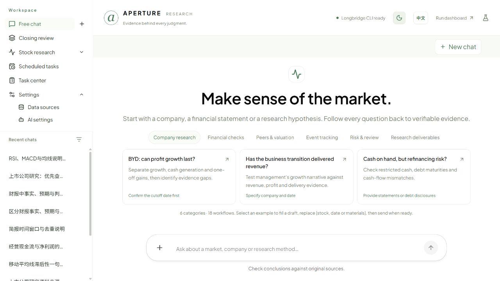
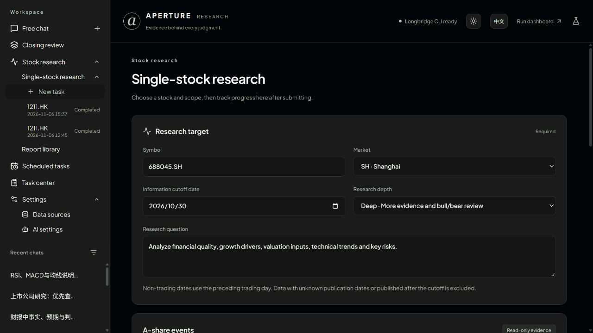
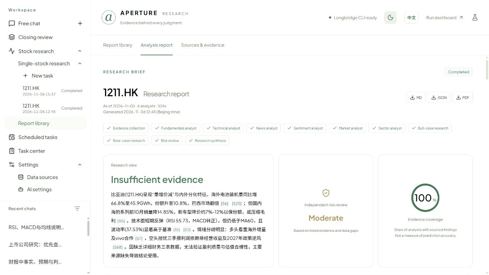
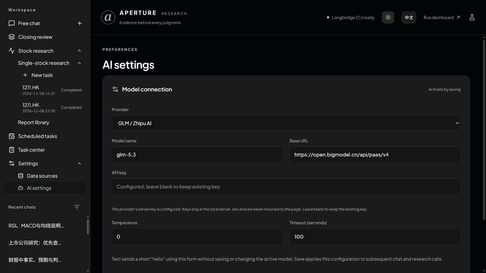
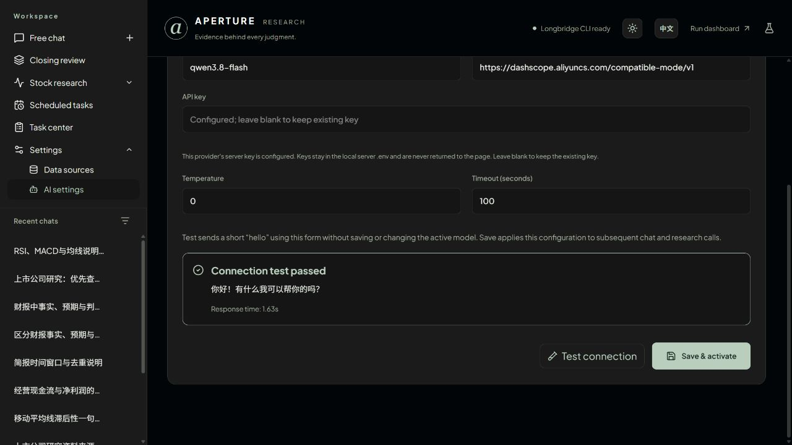
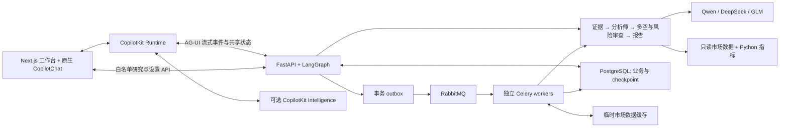

# Aperture · 金融研究助手

[English](README.md) | **简体中文**

基于 **CopilotKit、Next.js、LangGraph 和 FastAPI** 的金融研究工作台。从配置研究团队、查看真实工具过程，到核对报告来源和继续追问，把研究串成可追溯的工作流。支持自带 Qwen、DeepSeek 或 GLM API。

[界面预览](#界面预览) · [功能](#功能) · [数据](#数据) · [支持的-ai](#支持的-ai) · [快速开始](#快速开始) · [架构与开发](#架构与开发)

> 当前为单用户本机应用。公网 SaaS 所需的身份认证、租户隔离与计费尚未实现。应用只做只读研究，不访问券商持仓，不下单。

## 界面预览

以下是本机实际运行页面，研究样例采用公开市场资料。界面默认英文，主题按钮旁的 **EN / 中文** 可以切换语言并保存偏好；已有报告和对话保留原文。

### 自由对话与金融场景示例



### 单股研究配置



### 报告与来源证据



### AI 连接设置



连接测试反馈：



截图用于展示界面，不代表模型准确率或投资建议。英文界面可以展示原始中文报告。

## 功能

| 场景           | 当前能力                                                                                                                                   |
| -------------- | ------------------------------------------------------------------------------------------------------------------------------------------ |
| 自由对话       | 原生 CopilotKit 聊天、流式回答、可展开工具调用、服务商实际返回的推理内容及动态追问。18 个金融工作场景示例，点击只填入草稿，由用户发送。    |
| 单股研究       | 自选证券、市场、信息截止日期、深度和分析师。基本面、技术、新闻、情绪、大盘、板块六类分析师可选，支持多空与风险审查，多个研究任务独立运行。 |
| 执行跟踪       | 展示排队状态、研究阶段和预计剩余时间，完成后查看报告或进行绑定当前研究的问答。时间为估算，不是完成承诺。                                   |
| 报告库         | 检索与筛选历史报告，核对来源编号、发布时间和数据缺口；报告专属问答；导出 Markdown、JSON、PDF，生成时间精确到分钟。                         |
| 报告对照       | 同股跨日期回看，或同市场同截止日双标的对照。保存的行情按共同成交日对齐，支持 5/20/60 日窗口和首日设为 100 的曲线，不重新运行模型。         |
| A 股收盘复盘   | 选定样本相对基准表现、量比、涨跌停与炸板池、连板梯队、昨涨停次日表现及近期行业分布。                                                       |
| 候选与条件核对 | 保存观察、备注和候选标的，复用到复盘或定时计划；保存下一交易日可量化条件。服务运行且数据可用时，在目标日收盘后核对。                       |
| 定时研究       | 市场晨报、主题要闻、自选异动、公告追踪、周复盘和单股研究。预设只填写草稿，用户创建后才生效；支持启停、立刻运行、独立历史、单删和批量删除。 |
| 模型与外观     | Qwen、DeepSeek、GLM 分别保存配置；测试问候不保存，保存后启用。中英文、黑灰深色与清新浅色主题、手机布局。                                   |

### 保留原生 CopilotKit

保留 **CopilotChat、原生工具卡、AG-UI Streams、Generative UI、Shared State、Frontend Tools 和 Human in the Loop**，不伪造工具过程或思考日志。

Inspector、原生线程历史与学习接入依赖你配置的 **CopilotKit Intelligence**。Automatic Learning 在这里是技能提炼及审核发布流程，不是自动训练模型。上游原生能力演示保留在 `/playground`。

## 数据

可选的 **Langfuse** 通过 OpenTelemetry 接收研究/工具/模型的元数据追踪。服务端 `.env` 配置 `LANGFUSE_PUBLIC_KEY`、`LANGFUSE_SECRET_KEY`、项目区域对应的 `LANGFUSE_BASE_URL` 后重建服务。不导出问题、回答、原文和推理；可用时记录模型 token 用量。`APERTURE_TRACING_ENABLED=false` 可关闭。该集成补充原生 Inspector，产品内质量/性能评测中心仍在开发。

| 数据源                                        | 当前用途                                                     | 覆盖与限制                                                                     |
| --------------------------------------------- | ------------------------------------------------------------ | ------------------------------------------------------------------------------ |
| [Longbridge CLI](https://open.longbridge.com/) | 主要行情、日线、财务数据、新闻、公司公告、社区样本和交易日历 | 配置支持港股、美股、沪深及新加坡研究；具体可用性取决于账号权限和接口历史窗口。 |
| 腾讯财经                                      | 沪深未复权日线备用源                                         | 支持的 Longbridge 历史数据不足时使用，保留来源标识。                           |
| 东方财富公开数据                              | A 股事件、龙虎榜、限售解禁、股东增减持和收盘行情池           | 核对记录日期，在可验证时附发行人公告。行情池统计沿用来源口径。                 |
| 本地计算                                      | 均线、RSI/MACD、波动率、相对表现、条件核对与双报告价格对齐   | 由代码基于保留数据计算。未复权价格可能受公司行动影响，价格变化不等于总回报。   |

### 研究边界

- 用户选择信息截止日。晚于截止日或发布时间无法核验的证据会被排除；非交易日使用此前最近可用交易日。
- 财报期末不是披露日期。缺少三表或估值输入时保留缺口，不编造数字或目标价。
- 滚动新闻接口可能不覆盖很早的历史。接口返回空，不等于当时没有事件。
- 对照曲线只使用共同且有成交的日期，不填补停牌、缺失或重复记录。
- 日期过滤不构成完整的 point-in-time 回测数据库；证据覆盖率不代表模型预测准确率。

## 支持的 AI

三家都通过现有 LangChain/OpenAI 集成调用 OpenAI 兼容 Chat Completions。模型名称可编辑，请使用自己账户可调用的模型。

| 提供商                                                                                                    | 初始模型选项                                 | Base URL 环境变量      | API key 环境变量      |
| --------------------------------------------------------------------------------------------------------- | -------------------------------------------- | ---------------------- | --------------------- |
| [DashScope Qwen](https://www.alibabacloud.com/help/en/model-studio/compatibility-of-openai-with-dashscope) | `qwen3.8-flash`、`qwen3.8-max`           | `DASHSCOPE_BASE_URL` | `DASHSCOPE_API_KEY` |
| [DeepSeek](https://api-docs.deepseek.com/)                                                                 | `deepseek-flash`、`deepseek-v4-pro`      | `DEEPSEEK_BASE_URL`  | `DEEPSEEK_API_KEY`  |
| [GLM / 智谱](https://docs.bigmodel.cn/cn/guide/develop/openai/introduction)                                | `glm-5.3`、`glm-4.7`、`glm-4.7-FlashX` | `ZHIPU_BASE_URL`     | `ZHIPU_API_KEY`     |

在 **个人设置 → AI 设置** 中：

1. 选择提供商，每家分别保留模型、地址和生成设置。新配置优先读取 `.env` 中已有的对应地址和密钥。
2. 填写模型名、Base URL，以及可选的新 API key。密钥留空会保留当前密钥，服务端不会把已保存密钥回传页面。
3. 点击 **测试连接**：用当前表单发送一句“你好”，不用研究工具，显示成功、回复、耗时或失败原因；不保存、不切换正在使用的配置，最多等待 20 秒。
4. 点击 **保存并启用**：后续对话、研究与追问使用该配置，不重新启动已经完成的任务。

界面密钥保存在仅服务端可读的 `APERTURE_ENV_FILE`：容器使用应用私有共享卷，原生开发使用 `.env`。独立 worker 会读取保存后的新密钥，无需重启。非密钥配置存于 PostgreSQL。兼容 `GLM_API_KEY`、`ZAI_API_KEY`、`ZHIPUAI_API_KEY`、`GLM_BASE_URL`、`ZAI_BASE_URL` 别名，以 `ZHIPU_*` 优先。适配层处理推理参数差异，例如 GLM-5.3 的问候测试使用低推理强度。

问候测试验证基本认证和文本生成，不代表所有模型的工具调用、结构化输出和研究质量均已验证。模型可用性和账号权限可能变化。

## 快速开始

### 1. 环境要求

- **Node.js 20.19+**、npm
- **Python 3.12+**、[uv](https://docs.astral.sh/uv/getting-started/installation/)
- **Docker Desktop，Linux 引擎运行中**；当前固定开发镜像适用于 amd64
- 至少一家支持的模型服务 API key
- 自己的 [Longbridge](https://open.longbridge.com/) 权限，在应用容器内完成官方登录授权

### 2. 克隆并安装

```powershell
git clone git@github.com:A1f1ed/Financial_Research_Agent.git
cd Financial_Research_Agent/copilotkit-app
# 仅新克隆时执行；已有 .env 时保留原文件。
Copy-Item .env.example .env
npm ci
```

`npm ci` 同时通过 uv 安装 Python Agent 依赖。仓库不提供密钥、数据库或模型缓存。

### 3. 配置连接

可启动后在设置页面填写 AI 密钥，也可先在 `.env` 填入对应配置：

```dotenv
DASHSCOPE_API_KEY=
DASHSCOPE_BASE_URL=https://dashscope.aliyuncs.com/compatible-mode/v1
DEEPSEEK_API_KEY=
DEEPSEEK_BASE_URL=https://api.deepseek.com/v1
ZHIPU_API_KEY=
ZHIPU_BASE_URL=https://open.bigmodel.cn/api/paas/v4

# 保存界面配置前的初始模型：
COPILOTKIT_AGENT_MODEL=openai:qwen3.8-flash
```

原生线程历史、托管追踪与学习需要配置自己的 `CPK_INTELLIGENCE_API_KEY`、`INTELLIGENCE_API_URL`、`INTELLIGENCE_GATEWAY_WS_URL`；更改相关集成开关后重新构建前端。没有 Intelligence 时，本地报告、任务和 checkpoint 与原生自由对话的线程发现功能仍是分开的。

初始化服务凭证并启动数据库、API、独立 worker 后，在容器内授权市场数据：

```powershell
npm run infra:init
npm run services:up
docker compose --env-file ../infra/.env -f ../infra/compose.yaml --profile application exec api longbridge auth login
```

### 4. 构建并启动

```powershell
npm run build
npm run start:all
```

打开 **[http://localhost:3000](http://localhost:3000)**；FastAPI 默认监听 `127.0.0.1:8123`。先在设置中选择提供商、测试、保存启用，再开始研究。开发模式使用 `npm run dev`。

正式构建使用 Webpack，启动器读取项目 `.env` 并补齐 Next.js standalone 静态资源。独立迁移服务先准备 PostgreSQL 业务与 checkpoint schema，再启动 API/worker。旧版 SQLite 用户按 [基础设施说明](infra/README.md) 做经过验证的离线迁移和切换，启动新库不会自动搬迁旧数据。

### 5. 完整研究路径

1. 在股票分析下新建单股研究，设置标的、日期、问题及分析师并开始。
2. 跟踪执行阶段；每项单股分析是独立任务，可继续创建其他任务。
3. 打开报告中的 `[S…]` 引用，核对该报告对应的来源。
4. 就此报告追问，或在报告库对照已有研究。
5. 复用候选与条件，或填写定时计划草稿。创建计划始终由用户明确操作。

研究由独立 Celery worker 执行，API 重启不终止已提交任务。删除任务或计划会保留报告/历史。为迁移安全，自动调度默认暂停，「立刻运行」仍可手动试跑。验证后在 `infra/.env` 设置 `RESEARCH_SCHEDULER_ENABLED=true` 并运行 `npm run services:up`，持续运行 worker、Beat 与投递服务才能自动执行；主机休眠时本地服务不能运行。

## 架构与开发



模型解释证据；代码计算指标、调度时间、条件结果和报告价格对照。

### 数据与隐私

- 报告、任务、计划和配置：PostgreSQL `research` schema；LangGraph checkpoint：PostgreSQL `agent` schema；市场数据缓存：有 TTL 的 Redis。
- 旧 SQLite 文件仅供离线迁移，不作为运行回退；不使用 ChromaDB。
- API key：忽略的服务端配置/私有应用卷，不写入报告或设置响应；Longbridge 授权保存在容器的私有 home 卷，不复制主机 token。
- 模型调用会把相关问题和证据发送到所选服务商；托管 Intelligence 可以保存线程事件及追踪。本应用不是完全离线软件。
- 按 [基础设施说明](infra/README.md) 备份 PostgreSQL 和服务数据卷，不提交 `.env`、备份、凭证或私人研究材料。
- 当前没有公网访问认证，上公网前仍需实现访问控制和用户隔离。

### 验证

开发遵循 [Git/PR 规范](CONTRIBUTING.md)。本次 GitHub 交付按[四个逐点确认的检查点](docs/releases/knowledge-v0.2.md)执行：保存现有成果、完成 RAG/GraphRAG 验收、实现 App 内评测中心、最终验证并经 PR 合并；每点结束后等待用户确认。视觉、公司 Wiki/论点及增量知识跟踪留到下一版。当前分支为开发快照，不是已验收发行版。

```powershell
cd copilotkit-app
npm run build
npx tsc --noEmit
cd agent
uv run python -m unittest discover -s tests -v
```

Python 测试需要运行真实 PostgreSQL/Redis，使用独立测试库和缓存前缀，覆盖研究边界、任务、计划、报告对照、复盘、追问与提供商配置。提供商失败测试使用受控错误；真实连接测试会消耗少量模型请求。

研究知识功能已有在线集合/资料管理、限定范围关键词/混合检索、原生文档问答、人工核实数字与可复算的 Decimal 计算，以及单股任务的精确文档版本绑定。GraphRAG 支持自动提议、人工身份/关系审核、发布、可视化路径和文档聊天中的只读图谱工具。[检查点 2 验收记录](docs/validation/checkpoint-2-rag-graph.md)列出真实公开资料的网页闭环、生产模式 UI 验证及未覆盖项。参阅[资料库](docs/document-library.md)、[图谱研究](docs/graph-research.md)和[完整路线图验收矩阵](docs/validation/research-knowledge-validation.md)。App 内评测、视觉核验、Wiki/论点、高级生命周期/治理及完整生产验收仍待完成。目前为功能分支检查点，尚未最终发布或经 PR 合并。

实际验收路径和未覆盖项见 [验收记录](copilotkit-app/VALIDATION.md)，剩余缺口见 [研究路线图](copilotkit-app/RESEARCH-ROADMAP.md)。本机构建成功不代表已经达到商业化生产服务要求。

## 参考与许可

许可见 [LICENSE](copilotkit-app/LICENSE)。行情及模型服务遵循各自授权条款。输出仅供研究与学习，不构成个性化投资建议。
