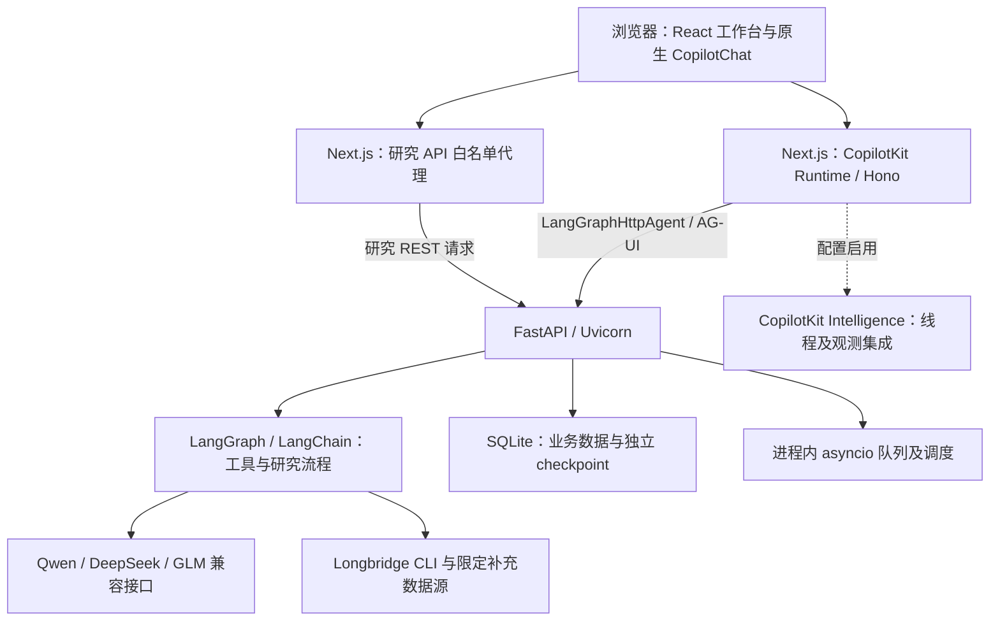
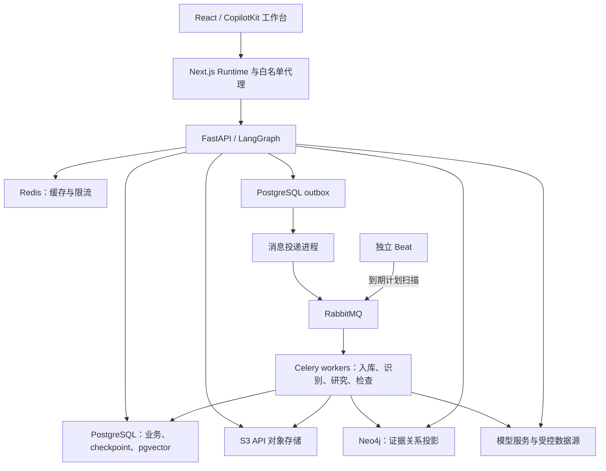

# Aperture Research：研究知识与证据工作流产品需求文档

版本：1.5 · 日期：2026-11-07 · 状态：完整路线图与分批发布基线

1.5 发布拆分（用户明确要求）：本次先完成 RAG 完整验收、GraphRAG 自动抽取的真实网页闭环、App 内评测中心及受影响研究工作台回归，通过功能分支和 PR 合并 GitHub `main` 后暂停。视觉、Wiki/论点、增量知识跟踪和高级治理放到下一次，不作为本次提交版的完成前提。具体范围和四个必须逐点等待用户确认的检查点见 [首版交付计划](releases/knowledge-v0.2.md)，Git 标准见 [CONTRIBUTING](../CONTRIBUTING.md)。下文 M0–M6 保留完整长期需求；本次 GitHub 版本完成不等于完整长期目标全部达成。第 1 点已完成；用户已明确同意开始第 2 点，第 3、4 点仍须等待各自确认。GitHub 发布不包含公网部署。

1.4 增补：知识库完整管理系统、GraphRAG 管理系统、GraphRAG 可视化、评测系统四项均必须在当前 App 内实现，并提供明确可发现的功能入口。GraphRAG 管理与可视化分别验收；不能以已有文档上传页面、单张关系图、外部数据库管理页或 Langfuse 后台替代完整业务模块。下文新增导航、管理范围和逐项交付门槛；要求已写入不代表功能已完成。

1.3 增补：按用户要求，文档在线管理、GraphRAG 交互可视化、Agent 内集成的质量/性能评测中心均为必须交付的软件功能。预置本地样本、CLI、离线评测脚本只用于开发和维护，不能代替日常网页操作；尚未实现的能力继续标记为待开发。

适用项目：当前仓库中的 CopilotKit + Next.js + LangGraph + FastAPI 金融研究工作台。

本文规定新增功能、业务边界和完成标准。现有资料收集脚本与本地样本已准备；本文中的 RAG、视觉核验、公司 Wiki、GraphRAG 和知识跟踪集成均不因此视为已完成。本文不授权自动推送或发布。

## 1. 可直接放入目标模式的目标

> 在现有 Aperture Research 项目中，实现并验证一套贯通“资料入库 → 财报及公告问答 → 表格与图表核验 → 带证据的研究报告 → 公司档案与论点维护 → 政策关系检索 → 定时变化跟踪”的产品功能。以本文为需求和验收基线，依照 M0–M6 分阶段完成。目标技术栈使用 PostgreSQL + pgvector、SQLAlchemy/Alembic、PostgreSQL-backed LangGraph checkpoints、Neo4j、RabbitMQ/Celery、Redis 和 S3 API 对象存储；迁移现有 SQLite 数据，新增和最终运行链路不使用 SQLite、ChromaDB 或内存向量库。保留 CopilotKit 原生聊天、工具调用、AG-UI 流式反馈、Shared State、Human in the Loop 和现有 Inspector 接入；保留现有单股任务、报告库、定时任务、历史恢复及多模型设置。优先使用已保存的真实资料，在每阶段完成后验证真实页面与关键业务分支。最终交付可运行代码、数据库迁移、配置及使用说明、可追溯评测集、实际验证记录和剩余限制；所有必须项通过后才算目标完成。

完成上述目标需要实际功能与验证证据。仅生成设计、接口壳、静态演示、模拟工具过程或无法追溯的数据，不算完成。缺少真实模型或服务权限时继续完成可独立验证的部分，明确记录阻塞的验收项，不把降级路径标为完整能力已通过。

**目标的明确必做项：知识库完整管理系统、GraphRAG 管理系统、GraphRAG 可视化、评测系统，以及四项对应的 App 内功能入口。** 四项必须与现有 Agent、资料/报告及任务中心贯通，不能作为仓库外的独立演示或仅供开发者使用的工具交付。

## 2. 产品定位与目标用户

目标用户是需要反复阅读公开材料、比较财务变化、追踪研究判断的个人研究者和金融分析师。首版保持单用户的产品权限范围，以可容器化复现、可迁移和可运维的服务架构开发；业务数据库、检索和后台任务采用企业应用常用组件。本机开发与最终验收使用同类服务，不设置 SQLite/ChromaDB 简化运行分支。

用户需要完成四类具体工作：

| 工作 | 用户需要得到的结果 | 新增能力的职责 |
| --- | --- | --- |
| 财报质量研究 | 利润、现金流、应收及存货的变化解释，数字可复算 | RAG 定位材料，代码计算，视觉核对表格 |
| 业绩材料核验 | 图表、演示口径与正式报表的对应及差异 | 视觉提取，文档检索，口径核验 |
| 持续公司研究 | 可更新的公司档案、研究论点及其证据历史 | Wiki 草稿、差异审核、版本与论点管理 |
| 政策和事件研究 | 事件影响路径，以及上次研究后发生的变化 | GraphRAG 关系检索、时间线、定时增量跟踪 |

产品界面以这些工作命名。技术术语可以出现在设置、开发说明或运行详情中，主操作不要求用户先理解 RAG、向量数据库或图数据库。

### 2.1 首版不包含

- 自动交易、券商持仓操作、自动生成投资收益承诺。
- 多租户 SaaS、组织协作权限、订阅计费和互联网生产部署。
- 全市场完整历史数据库、完整供应链图谱、付费研报批量转载。
- 无人审核的 Wiki 正式发布、无证据的公司关系补全、模型训练或微调。
- 任意网站抓取、实时交易级行情承诺，以及将所有第三方工具包整体接入。
- 全文机器翻译、视频和音频转录、Word/Excel 入库。首版先覆盖 PDF、PNG、JPEG；其他格式列为后续扩展。

## 3. 现状、资料与依赖

### 3.1 已有产品基础

仓库已有自由对话、六类分析师的单股研究、任务中心、报告及来源、报告问答、定时计划、模型设置和中英文/深浅主题。具体行为在 M0 复核，以实际代码和运行结果为准，不能仅依据 README 判定通过。

新增功能必须扩展这些流程，不能替换成另一套聊天系统。尤其保留任务独立性、报告绑定、历史打开不重跑、删除范围和计划历史。

### 3.2 开发样本

样本根目录：`local-data/finance-research-v1/`。来源目录：`data-catalog/finance-research-v1/`。

| 样本 | 用途 | 注意事项 |
| --- | --- | --- |
| 比亚迪 2024 年报、2025 中报 | 财务问答、合并现金流、期间比较 | PDF 页码与印刷页码可能不同 |
| 比亚迪 2026 年前三季度减值公告 | 公告问答、材料类型识别 | 不得充当完整三季报 |
| 比亚迪 2026 年 10 月产销公告 | 经营数据、时间穿越反例 | 11 月公开，不能用于截至 10 月 31 日的研究 |
| 吉利 2024 年报、2025 中报 | 同业研究、图表与报表核验 | 2025 中报公开日期未核实，严格历史研究先排除 |
| 吉利两份业绩演示 | 柱状图、现金流桥、调整后利润、管理层目标 | 2024 演示全部为图片页，需要 OCR/视觉 |
| 欧盟两份 2024 电动车政策新闻稿 | 政策阶段、实体及事件关系 | 历史新闻稿，不代表现行完整法规 |

当前样本统计：10 份 PDF、968 页、2,605 个基线文本片段、47 张页面渲染图。它们提供开发起点，不代表所有页已通过语义提取、OCR 或财务准确性验证。

已有 `evaluation-seeds.json` 的 10 个问题是待完善的评测种子，不是已验证的数值标准答案。原始文件、抽取正文、图片和索引保留本地；公开作品集使用经过权利核对的材料或独立制作并明确标记的合成演示样本。

### 3.3 模型与数据依赖

- 对话及文本抽取复用现有 AI 配置；embedding 和视觉需要独立的能力配置。
- 不假设同一厂商的任意模型都支持工具、视觉、结构化输出或 embedding。能力测试通过后才启用对应路径。
- embedding 与视觉模型均允许填写服务、模型名、Base URL、密钥并保存、测试；默认可复用已保存的同厂商凭证，密钥始终留在服务端。
- 测试 embedding 时检查有效非空向量、维度一致及错误反馈；测试视觉时使用本地非敏感小测试图并检查图片请求成功。文本“你好”测试不能代替这两项测试。
- 无 embedding 时提供明确标识的全文检索降级；无视觉时可读文本页仍可使用，图片页提示未识别。不能将降级展示为全部功能已就绪。
- Longbridge 保留为已有研究数据入口；公司、交易所和官方政策文件作为文档证据。其他工具包按经验证的具体业务缺口接入，不作为本轮全部实现的前置条件。

### 3.4 当前技术栈：前端与交互

以下是 2026-11-06 对当前代码、`package.json`、`package-lock.json`、`agent/pyproject.toml` 和 `agent/uv.lock` 的核对快照。表中的精确版本来自锁文件，不表示上游最新版，也不表示本轮重新安装或验证了所有运行时依赖。未来升级需同时复核兼容性及锁文件。

| 层级 | 当前技术 / 锁定版本 | 当前职责与使用边界 |
| --- | --- | --- |
| 应用框架 | Next.js 16.3.8，App Router | 页面、服务端路由、CopilotKit Runtime 和研究接口代理；构建输出为 standalone |
| 页面与语言 | React / React DOM 19.3.0，TypeScript 5.9.3 | React 客户端工作台，TypeScript strict 类型检查；React 声明范围为 `^19.2.4`，以锁定版本为当前复现依据 |
| 样式 | Tailwind CSS 4.3.3，自定义 CSS/CSS Modules | 语义颜色、工作台布局、深浅主题及组件样式 |
| 基础组件 | Radix UI primitives，CVA，clsx，tailwind-merge | 项目自有 `src/components/ui/` 组件的交互和样式组合，不依赖另一个完整聊天 UI 框架 |
| 图标及图表 | Lucide React 0.577.0，Recharts 3.10.1 | 导航/操作图标、已有研究图表和生成式图表 |
| 原生聊天 | `@copilotkit/react-core` 1.79.0，v2 接口 | `CopilotChat`、`CopilotChatView`、`CopilotThreadsDrawer`、Agent 状态、前端工具及人工交互 |
| 生成式界面 | `@copilotkit/a2ui-renderer` 1.79.0，项目 A2UI catalog | A2UI/Open Generative UI 接入；上游演示与金融生产数据用途分别处理 |
| 状态与历史回放 | React hooks/Context，RxJS 7.8.1，AG-UI 客户端 | 页面状态、历史事件解析/回放及有限内存缓存；未采用独立 Redux/Zustand 状态层 |
| 中英文及主题 | 项目自有 LanguageProvider、ThemeProvider 与翻译字典 | 默认英文、中文切换和主题持久偏好；不等同于自动翻译已有报告内容 |
| 输入验证 | Zod 3.25.76（前端依赖），后端 Pydantic | 按现有代码职责做结构校验；关键业务规则以服务端校验为准 |

AG-UI JS 依赖通过 overrides 固定为 1.0.2。CopilotKit 前后端包使用不同版本体系，不能为了版本号一致而直接将 Python 包升级成 JS 包版本。

### 3.5 当前技术栈：代理、API 与模型

| 层级 | 当前技术 / 锁定版本 | 当前职责与使用边界 |
| --- | --- | --- |
| Python 环境 | Python 要求 `>=3.12`，uv + `uv.lock` | Agent 依赖安装和运行；具体解释器版本需在实际验收时记录 |
| HTTP 服务 | FastAPI 0.115.12，Uvicorn 0.38.0 | 研究、任务、计划、设置、报告导出及 AG-UI Agent 服务，默认本机 8123 端口 |
| 数据契约 | Pydantic 2.14.0 | 股票研究配置、计划、模型设置与输出结构验证 |
| Agent 编排 | LangGraph 1.2.11，LangChain 1.4.0 | Agent 图、工具执行、研究分析与共享状态；当前使用 LangChain `create_agent` 及项目自有研究工作流 |
| 协议桥接 | Python `copilotkit` 0.1.96，`ag-ui-langgraph` 0.0.44，`ag-ui-protocol` 0.1.22 | 将 FastAPI 中的 Agent 暴露为 AG-UI 接口，保留流式文本、真实工具过程和状态事件 |
| Next.js Agent Runtime | `@copilotkit/runtime` 1.79.0，Hono 4.13.8 | `/api/copilotkit` 路由通过 `LangGraphHttpAgent` 连接 FastAPI；不是 LangGraph Platform 托管部署 |
| 研究 API 代理 | Next.js Route Handler + Fetch | `/api/research/[...path]` 仅转发白名单路由；当前写请求只接收 JSON，新增文件上传需扩展受控接口，不能直接沿用 JSON 代理假设 |
| 模型调用 | `langchain-openai` 1.1.9，OpenAI Python SDK 1.109.1 | Qwen、DeepSeek、GLM 的 OpenAI-compatible Chat Completions；项目适配器转发服务实际返回的 reasoning 内容 |
| 其他模型依赖 | `langchain-anthropic`、`langchain-google-genai` | 保留 starter 的解析/集成能力；当前金融产品设置页正式配置的是 Qwen、DeepSeek、GLM，不据此宣称其他厂商已完成产品验收 |
| 模型配置 | 服务端 `.env` + SQLite 中的非敏感 profile | 不同厂商保存独立 profile，支持测试与保存激活；密钥不返回浏览器 |
| 可观测性/学习 | CopilotKit Intelligence 条件接入，`copilotkit-intelligence-langgraph` 0.1.0；LangSmith 0.7.33 依赖 | 原生历史/Inspector 等取决于 Intelligence 配置；技能 middleware 还需 learning container。LangSmith 有依赖不代表本机已启用追踪 |

`ag-ui-langgraph` 及协议版本有现有兼容性固定说明，新增功能应先在当前组合上实现。模型厂商及具体 model ID 的可用能力需分别测试；普通对话成功不表示视觉、embedding、工具调用都成功。

### 3.6 当前技术栈：持久化、任务、数据与文档

| 模块 | 当前实现 | 对本需求的影响 |
| --- | --- | --- |
| 业务持久化 | Python `sqlite3`，WAL；`research.sqlite3` | 保存报告、缓存、profile、任务及计划等；部分实体以 JSON body 保存，新增规范化事实/版本需要兼容迁移 |
| Agent checkpoint | `langgraph-checkpoint-sqlite` 3.1.3，`AsyncSqliteSaver`，`checkpoints.sqlite3` | 保存 Agent 消息/状态；与业务数据库及托管线程发现是不同职责，不能互相当作替代 |
| 原生线程与运行 | 配置 Intelligence 时接入原生线程服务；否则 Runtime 使用 `InMemoryAgentRunner` | 不能将无 Intelligence 的运行内存当作完整持久线程目录；当前仍是单用户身份接入 |
| 队列和调度 | SQLite 持久任务 + FastAPI lifespan 启动的 `asyncio` worker | 项目自有队列、交易日历调度和检查循环；未使用 Celery、Redis 或独立调度集群，服务进程停止即不能继续执行 |
| 任务更新 | 研究 REST 状态查询/轮询 | 与聊天 AG-UI 流分工不同；新文档任务需要复用状态模型并控制轮询，而非宣称已有统一任务推送总线 |
| 行情及披露 | Longbridge CLI 子进程白名单调用 | 已有超时、权限错误处理及 SQLite 缓存；具体账号可用范围需实际验证 |
| 补充市场源 | 腾讯历史日线、东方财富公开数据及项目适配器 | 当前用于限定的行情回退、A 股事件/复盘等，不能视为两个外部工具包已经整体接入 |
| 财务/行情计算 | Python 标准库与项目自有公式 | 已有指标、对照和条件检查；新增财务计算需保存可复算输入及口径 |
| 报告导出 | Markdown、JSON，ReportLab 5.1.0 生成 PDF | 现有成果导出；PDF 报告生成与文档 RAG 入库是不同流程 |
| 应用内 PDF 读取 | pypdf 6.21.4 | 已有特定 A 股材料读取路径，不是通用 OCR 或完整财报检索服务 |
| 本地资料准备 | PyMuPDF 1.26.7、HTTPX 0.28.1，`scripts/data/` | 原文下载、文本/坐标抽取、页面渲染和哈希验证；PyMuPDF 当前列在 dev 依赖组，若应用运行期需要它，须调整部署依赖 |
| 当前报告附件 | 文本附件处理与原生附件 UI | 报告专属问答的现有后端处理 UTF-8 TXT/Markdown/CSV，存在大小限制；不能把可见上传按钮当作 PDF/图片视觉能力已完成 |

业务数据目录可由 `RESEARCH_DATA_DIR` 配置，默认在 `agent/data/`。当前收集的研究原文及衍生物另存在根目录的 `local-data/`，不能混同为已经入库的业务知识库。

### 3.7 当前运行链路与开发检查

| 项目 | 当前做法 |
| --- | --- |
| JS 依赖 | npm + `package-lock.json`；`npm ci` 的 postinstall 调用 uv 安装 Agent 依赖 |
| 开发启动 | `npm run dev`，通过 concurrently 启动 Next.js Turbopack 与 Python Agent |
| 生产构建/本机运行 | `npm run build` 使用 Webpack；`npm run start:all` 运行 Next.js standalone 与 FastAPI；默认本机 3000 / 8123 |
| 启动前检查 | `dev:infra` 当前仅检查必要配置并提示，不代表启动了 Docker、向量数据库或托管基础设施 |
| 类型及 Python 测试 | TypeScript strict/`tsc --noEmit`、Next.js build，Python `unittest` 与现有领域测试；已有 smoke 脚本及人工页面验收记录 |
| UI 验收 | 按 `copilotkit-app/AGENTS.md` 及当前用户偏好执行；实际路径、错误和未覆盖项进入验收记录 |
| 当前部署边界 | 单用户本机应用；未完成公网 SaaS 身份认证、租户隔离和生产运维。Runtime 的示例用户身份不能用于直接多用户上线 |

### 3.8 目标技术栈与当前实现的差距（必须执行）

第 3.4–3.7 节仅描述改造前的真实状态，其中 SQLite、进程内 worker 和本地文件路径不是后续选型建议。本节及第 13 节规定新的实现目标；若其他历史说明与之冲突，以目标架构为准。

选型依据是数据一致性、持久化、并发执行、迁移、可观测性及部署维护能力。使用这些组件不自动意味着已完成高可用、企业认证或多租户 SaaS；这些产品范围仍按第 2.1 节执行。

| 层级 | 目标选型 | 必须承担的职责 |
| --- | --- | --- |
| 前端与 AI 交互 | 保留 Next.js / React / TypeScript / CopilotKit | 保留原生聊天、工具卡、流式交互、生成式界面及现有 UI；不因基础设施迁移重写聊天框架 |
| API 与代理编排 | 保留 FastAPI / Pydantic / LangGraph / LangChain | 清晰的接口契约、领域服务与工具编排，API 与长任务执行解耦 |
| 主数据库 | PostgreSQL | 资料元数据、事实、Wiki 版本、审核、任务、计划、运行、引用与 outbox 的权威存储；约束、事务及查询索引完整 |
| 数据访问与迁移 | SQLAlchemy 2.x API + psycopg 3 + Alembic | 明确事务/会话边界、连接池、版本迁移及 schema 检查；API 与 worker 不共享跨进程连接；具体兼容版本在 M0 锁定 |
| Agent 状态 | `langgraph-checkpoint-postgres` 的 PostgreSQL saver | 替换 SQLite checkpoint，保留线程和消息/工具状态；与业务表分 schema 或明确隔离职责，做连接池和升级验证 |
| 语义及关键词检索 | pgvector + PostgreSQL 全文/关键词检索 | 持久向量、文档/模型版本过滤、混合排序和日期/范围约束。中文分词或关键词策略在 M0 验证，不能假设英文全文配置能直接覆盖中文 |
| 关系检索 | Neo4j + 官方 Python driver / Cypher | 具有证据和时间属性的实体关系、有限跳数路径检索；不使用 SQLite 邻接表作为最终 GraphRAG 实现 |
| 后台执行 | Celery workers + RabbitMQ broker | 入库、embedding、视觉、研究及检查任务独立于 API 进程执行；消息确认、有限重试、超时、幂等、取消及恢复 |
| 定时调度 | 独立 Celery Beat 调度进程 + PostgreSQL 中的业务计划 | Beat 触发到期计划扫描，计划/游标/互斥状态仍以数据库为准；单一有效调度器，不能每启动一个 API 副本就重复触发 |
| 缓存与短期协调 | Redis | 有 TTL 的数据缓存、限流及短期协调；不作为报告、知识版本、任务最终状态或唯一可靠锁的权威存储 |
| 原文与页面对象 | S3 API 对象存储 + Python S3 client | 保存原始 PDF、页面图及大体积衍生物；PostgreSQL 保存对象 key、哈希和元数据；受控读取/短期签名链接，不公开整个桶 |
| 工程观测 | 现有 CopilotKit Inspector + OpenTelemetry + 结构化日志 | 保留 AI 工具过程，关联 API/队列/worker/检索的运行与 trace ID；日志和 trace 脱敏，模型正文按配置采集 |
| 可复现环境 | Docker + Docker Compose | web、API、worker、Beat、数据库、broker、缓存、图数据库及对象存储可按明确配置运行，带健康检查、数据卷、资源限制和启动说明 |
| 自动验证 | 保留 TypeScript 与 Python 领域测试，增加真实服务集成测试和 CI | CI 使用隔离 PostgreSQL/pgvector、Neo4j 和队列服务，不以 SQLite 替代数据库行为验证 |

向量选型采用 [pgvector](https://github.com/pgvector/pgvector)，它直接为 PostgreSQL 提供向量相似度检索；Agent 状态采用 LangGraph 官方的 [PostgreSQL checkpoint 实现](https://github.com/langchain-ai/langgraph/tree/main/libs/checkpoint-postgres)。两者的迁移、连接池与数据职责分别验证，不能假设更换连接字符串就能完成全部改造。

SQLAlchemy 的事务和异步会话按[官方 asyncio 文档](https://docs.sqlalchemy.org/en/20/orm/extensions/asyncio.html)落实，schema 变更由 [Alembic](https://alembic.sqlalchemy.org/en/latest/)管理。任务 broker 采用 Celery 支持的 [RabbitMQ](https://docs.celeryq.dev/en/stable/getting-started/backends-and-brokers/rabbitmq.html)；这是本项目的选型，不要求追加 Kafka 或 Kubernetes 才能验收。

S3 目标定义为 [S3 API 对象存储接口](https://docs.aws.amazon.com/AmazonS3/latest/userguide/Welcome.html)。本地 Compose 选用经维护状态及许可核对的兼容实现，云部署可配置实际对象存储；在 M0 锁定本地实现、镜像和版本。开发验收必须实际走对象存储读写，不能把普通目录映射伪装成 S3；不要求本轮开通付费云资源。

Neo4j 使用[官方 Python driver](https://neo4j.com/docs/python-manual/current/connect/)；跨服务追踪采用 [OpenTelemetry](https://opentelemetry.io/docs/languages/python/instrumentation/)，本机复现使用 [Docker Compose](https://docs.docker.com/compose/)。新依赖版本、数据库扩展和镜像摘要在实现时锁定兼容组合，不盲目采用未测试的最新标签。

### 3.9 新增能力的实现落点

| 能力 | 当前状态 | 本轮开发要求 |
| --- | --- | --- |
| 持久化文档 RAG | 只有资料准备与现有特定材料处理，没有通用入库/问答链路 | 在 PostgreSQL + pgvector 建立文档版本、全文/关键词检索、embedding、混合排序和可定位引用；原文在对象存储中管理 |
| OCR / 视觉理解 | 能渲染原始页，未建立视觉识别、结构化核验及审核链路 | 增加能力配置、选页调用、提取结果及人工核实；渲染图片不算识别成功 |
| 公司 Wiki / 论点 | 现有研究报告和业务记录不等于版本化公司知识 | 增加事实模型、待审差异、版本冲突、历史视图和论点检查 |
| GraphRAG | 尚未建立证据化实体/关系存储及关系检索 | 以 Neo4j 实现实体、边、时间过滤和有限跳数检索；PostgreSQL 保留审核/原始关系记录及投影版本，必须有真实路径和逐边证据 |
| 新后台处理 | 当前为进程内调度，尚无文档处理 worker | 迁移到 RabbitMQ/Celery，独立 Beat 调度；API 仅提交、查询与控制，数据库记录最终状态 |

不引入 ChromaDB、SQLite 向量扩展或仅内存的向量索引作为开发/生产实现；不同时维护 pgvector 和第二套向量数据库。SQLite 仅允许作为旧数据离线迁移工具的只读输入及回滚快照，不作为新运行链路、集成测试或自动故障回退数据库。

### 3.10 目标运行链路

PostgreSQL 是业务事实的权威来源；Neo4j、向量索引及缓存均有明确的重建/同步规则。任务消息只携带 ID 和必要控制字段，大文件与完整报告不进入 broker；工具事件仍由真实执行产生，并通过现有 AG-UI/任务状态契约展示。

## 4. 核心用户旅程与界面入口

### 4.1 完整旅程

用户新增研究任务，选择公司、日期、问题及使用的资料 → 系统展示资料状态与日期可用性 → 用户开始研究 → 原生工具卡展示检索、读取、核验及计算 → 输出带证据的报告 → 用户就此报告追问 → 用户将有价值内容加入公司档案或论点 → 审阅并发布版本 → 用户选择是否创建跟踪计划。

任何建议或预设只填写草稿。创建任务、发送问题、发布档案更新、创建定时计划等有明确的用户操作，不能由页面打开或历史恢复隐式触发。

### 4.2 导航及页面

| 位置 | 新增或扩展行为 |
| --- | --- |
| 自由对话 | 可选择研究资料或公司档案；显示本轮实际使用的范围；无范围时不默认携带最近一份报告 |
| 股票分析 → 单股分析 | 配置中增加“研究资料”；选择已有文档或导入；配置和分析师选项默认展开 |
| 工作台 → 知识库 → 研究资料 | 知识库/资料集合管理、文档列表、在线上传/来源导入、状态、元数据、版本、索引覆盖、检索、预览、重试及归档恢复；单股配置中保留同一模块的快捷入口 |
| 工作台 → 知识库 → 公司档案与论点 | 公司摘要、指标、业务、风险、管理层目标、论点、时间线、版本及待审核更新；与所属资料集合互相定位 |
| 工作台 → GraphRAG → 图谱管理 | 图谱及数据范围、实体/别名、关系及证据、候选审核、关系版本、抽取/同步任务、投影健康与重建记录 |
| 工作台 → GraphRAG → 关系图与路径 | 真实查询生成的交互图、时间/实体/关系筛选、逐边证据、可读路径表、保存查询；与管理页互相定位 |
| 报告库 | 保留现有报告；新增“查看引用页”“核验数字”“建议更新公司档案” |
| 定时任务 | 增加公司知识更新、研究论点检查、政策事件追踪预设；保留手动创建、启停、立刻运行、历史和删除 |
| 任务中心 | 将资料处理、研究、核验和跟踪运行按类型筛选；计划和运行实例分别展示 |
| 个人设置 → AI 设置 | 在现有对话配置附近增加 embedding 与视觉能力配置和测试状态 |
| 工作台 → 评测中心 | 评测集与版本、运行配置、后台评测任务、质量/性能结果、版本对照和失败明细 |

导航沿用现有折叠规则和图标风格。研究资料是原始文件，报告库是生成成果，公司档案是经过审核的累积知识，三者必须能互相跳转且含义清楚。

以上是目标导航，不宣称当前版本已全部实现。现有“股票分析 → 研究资料”迁入知识库时保留上下文快捷跳转，使用同一份资料与状态，不能建立两套互不一致的库。

### 4.3 通用交互要求

- 页面默认英文，提供中文切换；新入口、状态、错误、空状态均覆盖两种语言。
- 保留偏黑的深色和清新的浅色主题；删除使用危险色；正文、滚动条、弹窗与现有工作台一致。
- 证据优先在侧面板打开，保留当前对话位置；支持返回与键盘操作。页面定位、加载中和失败状态不得闪回自由对话首页。
- 上传入口必须可用：展示待上传项、文件名、大小、处理状态、取消与错误；移除附件不会自动删除已经入库的原文。
- 快速切换会话、报告、文档后，迟到响应不能覆盖当前范围。历史工具卡是历史记录，不会再次执行。
- 不制作假的思考过程、工具卡或进度百分比。估计剩余时间来自实际阶段及历史耗时，并注明估计；没有依据时仅展示当前阶段和已用时间。

### 4.4 四个 App 内模块的交付门槛（1.4 增补，必须）

| 需求编号 | 必做模块与入口 | 用户必须可以在 App 内完成 | 不构成完成的替代品 |
| --- | --- | --- | --- |
| APP-KB | 知识库完整管理；侧栏“知识库”及其资料、公司知识入口 | 新建/编辑/归档资料集合，上传/导入及管理新文档、元数据/文件版本、索引任务/覆盖，限定范围检索问答，查看引用、知识更新及恢复 | 仅本地预置文件、上传按钮或固定问答演示 |
| APP-GM | GraphRAG 管理；侧栏“GraphRAG → 图谱管理” | 配置图谱范围，管理实体与别名、审核有证据的关系、处理冲突、查版本、发起抽取/同步/重建并追踪状态 | Neo4j Browser、Cypher 命令或只能阅读的节点列表 |
| APP-GV | GraphRAG 可视化；侧栏“GraphRAG → 关系图与路径” | 搜索/筛选/展开真实关系、缩放/定位，节点与路径联动，打开逐边原页证据，保存和复用查询 | 静态图片、硬编码节点或与管理数据脱节的浏览器内图 |
| APP-EV | 评测系统；侧栏“评测中心” | 管理评测集/版本，配置并启动真实后台运行，查看质量/性能及失败明细、比较运行和导出；在 Agent 中查询/操作授权范围内的评测 | 离线 JSON/脚本、预录曲线、一次模型连接测试或仅跳转 Langfuse |

- 四项入口均需有对应图标、当前选中状态、可直接返回的列表/详情，以及双语、深浅主题、加载/空数据/失败/重试状态。一级入口或其直接子入口可以发现，不要求用户先创建研究或找到开发文档。
- 各模块共用当前服务端权威数据和持久任务。管理页的新增、审核、归档及索引变化必须在检索、图视图和任务中心按一致性规则反映；失败/延迟如实提示，不能仅更新前端展示。
- Agent 原生工具返回对应资料、图谱、运行及证据 ID，并能定位回 App 的同一业务对象；聊天结果和管理页面不得各维护一份模拟状态。
- 本节不扩大为多租户、任意市场完整图谱或无人审核发布；继续遵守第 2.1 节业务边界。

## 5. F1：研究资料入库与生命周期（必须）

### 5.1 用户操作

用户在浏览器批量上传 PDF 或图片，或粘贴受支持的官方来源文件链接导入。无需开发者预先将文件复制到服务器，也无需手工修改 JSON 目录。来源目录与 CLI 批量导入属于额外维护入口，不是唯一入口。填写或核实公司、材料类型、标题、来源、公开日期及统计期间。服务器自动识别的元数据以建议展示。

首版默认限制：PDF 每份不超过 50 MB、500 页；PNG/JPEG 每张不超过 20 MB、30 百万像素；单次最多 10 份文件。限制可由服务端配置，前后端一致，超限给出可操作说明。内置样本使用受控本地导入，仍需做完整性检查。

### 5.2 处理规则

1. 校验实际文件类型、文件大小、加密或损坏情况，计算内容哈希，保留不可变原始文件。
2. 同一原始字节重复导入复用文档版本及索引，不重复扣费；不同字节即使同名也建立新版本，要求确认是否替代旧版本。
3. 按页抽取文字和版面位置，识别低文本或图片页。保留原文、抽取文本、OCR/视觉结果各自版本，不能覆盖原文。
4. 生成带文档版本、页码及位置的片段并建索引。表格、脚注与普通段落分类型保存，跨页表格保留关联。
5. 文字页可先完成文本索引；未识别的图片页标记为待视觉处理，说明当前资料覆盖不完整。
6. 失败按页/阶段记录，可重试失败部分，已成功的原文和页不丢失。重启后恢复状态，不将中断任务永久标为运行中。

### 5.3 状态及来源日期

资料处理状态与研究可用性分开保存：

- 处理：待处理、处理中、部分可用、可用、失败、已归档。
- 页面：文字可读、需视觉、识别待核实、已核实、失败。
- 当前研究可用性：符合截止日期、晚于截止日期、公开日期未知、公开日期精度不足。

严格历史模式使用市场当地日期的日末作为用户选择日期的截止点。只有公开日而没有时分秒的材料可用于该日结束后的按日研究；不能支持该日内具体时刻的已知信息断言。按时刻研究必须说明如何处理时间精度不足的来源。

统计期、财报签署日、下载时间、网页路径中的月份都不能冒充公开时间。来源日期未知时，严格模式排除；探索模式允许用户主动纳入，但持续显示“公开日期未核实”，结果不能标为严格历史研究。已核实来源日期的人工修订保留审核轨迹。

### 5.4 归档及删除

被报告、Wiki 或论点引用的资料，默认归档并从新检索中排除，历史引用保留。单删/批量删除在居中确认框显示数量、范围及引用影响。永久移除文件必须明确后果；保留来源和引用的墓碑记录，历史引用显示原文已移除，不能跳转到其他版本。

### 5.5 在线管理系统（1.3 增补，必须）

- 提供日常使用的资料列表及详情：按公司、类型、公开日期、处理状态、归档状态筛选和搜索，分页；列表仅读取元数据。支持批量上传、批量归档、恢复归档，以及带引用影响的删除确认。
- 上传前展示文件队列、大小与校验反馈；上传、文本抽取、索引、视觉是不同阶段。服务端返回持久任务 ID，离开页面或刷新后可以从任务中心继续查看；取消/重试均针对明确阶段。失败文件不会导致同批其他成功文件丢失。
- 详情页可编辑标题、公司标签、材料类型、公开时间及其核实依据；元数据修订有版本和审计记录，历史报告引用保持原快照。更正公开日期后，新检索立即采用新可用性规则，不篡改旧报告。
- 提供 PDF 原页/图片预览、页码跳转、提取文本与索引覆盖状态、原文下载、处理历史和引用列表。签名下载或后端流式读取必须经过服务端范围校验，不能直接暴露存储凭证或任意对象键。
- 官方链接导入先校验来源域名、HTTPS、DNS 结果、每次重定向、实际文件类型、大小与下载超时；拒绝 localhost、私网、云元数据地址及任意服务器路径。默认允许已验证的公司/交易所/官方政策来源；来源扩展需要显式配置，不通过开放任意抓取绕过限制。
- 来源连接页展示可用来源、最近成功同步、错误及游标；用户可从界面发起发现/导入、配置跟踪计划。发现到的新文件也进入相同生命周期，不另建只为演示存在的导入链路。
- 在全新数据库、空对象存储、不含本地样本目录的环境中，必须通过网页上传新文件完成入库、检索、引用及归档验收。另用一次官方链接导入验证端到端流程，预加载目录不能代替此项。
- “在线”指浏览器和持久后台服务可管理真实新资料；当前单用户权限范围不自动扩大为多租户 SaaS。向公网部署仍需相应认证、传输与访问控制，不因提供上传表单而声称公网生产就绪。

### 5.6 知识库完整管理范围（1.4 增补，必须）

- 知识库不仅是文件列表。用户可在网页新建、重命名、编辑说明、归档和恢复资料集合，并按公司/主题组织资料；每份原文仍使用唯一文档及版本 ID，加入多个集合不重复存储或重复扣费。
- 集合详情展示资料/版本、已提取及已索引页数、待视觉/待审核/失败项、来源连接、处理任务和相关公司知识。统计来自服务端实际状态；尚未建索引与“检索无结果”必须能区分。
- 文档添加/移出集合、集合归档、索引重建前展示影响范围及引用影响。移出集合不等于永久删除原文；归档不篡改报告快照。恢复只使符合日期和处理规则的资料重新可用，不自动重跑收费任务。
- 在集合内直接发起限定范围检索和文档问答，查看命中页/片段、出处及覆盖缺口；选择多集合必须展示合并范围，服务器执行隔离和日期校验。公司档案/Wiki、论点和关系研究与原文及已发布知识互相跳转。
- 网页可查看入库、抽取、索引、视觉、更新及重建的处理历史，取消/重试明确阶段；来源连接和同步游标按第 5.5、11 节实现。日常设置和恢复不要求用户手工编辑数据库或运行脚本。
- 新集合/资料在刷新和服务重启后保留；单条、批量、取消、快速筛选及并发修订均验证实际范围。完整管理按 APP-KB 验收，不能以“文件能上传”替代。

## 6. F2：有范围、有日期约束的文档问答（必须）

### 6.1 代表场景

问题：“比亚迪 2025 年上半年利润增长是否获得经营现金流支持？指出应收账款、存货或其他需要核查的项目。”

输入为选定公司、截至日期和资料集合；输出为结论、数字/计算、证据和缺口，不能直接把所有片段拼进提示词。

### 6.2 业务流程

1. 固定本次会话/任务的公司、报告及文档版本范围。
2. 先排除不符合公开日期和权限/归档条件的材料，再进行关键词及语义检索。
3. 对候选片段排序，必要时扩展相邻段、表格页和脚注；限制上下文长度，保留实际引用记录。
4. 财务数字通过有类型的抽取和计算工具处理；计算过程保存输入值、单位、期间、公式和来源。
5. 回答区分披露事实、计算结果、分析判断及数据不足。无足够证据时说明缺什么，不生成确定结论。
6. 每一处关键事实与数值均能定位文档版本和 PDF 页；图表/表格同时可定位区域。

### 6.3 必须支持的问法

- 单文档定位：某个财务项目、风险、管理层目标出现在何处。
- 同期间同比：优先使用同一报告中的可比列，并识别重述或会计口径变化。
- 跨期间比较：说明全年、半年、季度或累计期间的区别；允许比较但不得伪装为同比。
- 两家公司比较：先核对币种、单位、期间、合并范围和指标定义；不能对齐的项目并列解释，不强行排序。
- 报告追问：只在绑定报告的证据及其允许范围内回答；扩展其他资料须有显式范围选择。
- 无答案：资料不存在、检索未找到、接口失败及模型无法确认分别提示，不能相互替代。

引用至少包含原文标题、来源网址（若有）、文档版本、PDF 页、公开日期及相关摘录。模型只能引用本轮提供且确实存在的证据 ID；发现无效 ID 时修正或返回证据不足。

## 7. F3：视觉理解与财务核验（必须）

### 7.1 代表场景

- 读取吉利 2024 演示的图片型柱状图，提取收入、汽车销售收入及平均售价，保留单位和图中文字。
- 解释吉利 2025 中期现金流瀑布图，核对期初现金、各项变化、期末现金和净现金之间的关系。
- 对比业绩演示中的调整后利润与正式报表，解释定义差异。

### 7.2 识别与核验规则

- 自动发现图片页，但大范围视觉识别作为有页数和费用估计的任务展示；默认先处理用户选中的页和检索确需的页，不扫描整库。
- 图片页识别、财务表格抽取、图表解读分别产生结构化结果；每个数值保存期间、单位、项目、所属系列/列、位置和来源。
- 低清、遮挡、表头不完整或模型输出不一致时，标为待核实，允许用户修订。模型自报置信度不等同于校准的正确率。
- 原图文字与系统计算分开：若图上的同比标注与读到的数值计算不符，同时展示原标注与计算值并提示复核，不擅自改写原文。
- 现金流桥验证正负号、加总及脚注；净现金与现金及等价物分别处理。
- 法定利润与调整后利润建立明确的指标定义及调整项，不把其中一个覆盖成另一个。
- 核验容差依据原文单位和舍入规则，展示具体差额；不能用统一的大容差掩盖错列或数量级错误。
- 缺一页、缺脚注或缺可比披露时返回“无法完成核验”，保留已知结果。

### 7.3 人工确认

核验卡展示原页、提取字段、公式、差异及状态。用户可以确认、修改或拒绝字段；保留原模型值与用户修订。未核实字段可以在回答中带明确标记展示，不能自动发布为 Wiki 正式数值事实。

核验结果状态为一致、存在可解释差异、发现冲突、证据不足或待人工核实。全部状态需要可见的理由，不能只显示一个绿色勾选。

## 8. F4：公司档案（LLM Wiki）与版本审核（必须）

### 8.1 档案结构

公司档案至少包含公司身份、业务及地区、关键财务指标、管理层目标、已披露风险、事件时间线、研究论点和数据缺口。摘要中的事实由结构化记录生成，可打开来源；不保存成一段无法追溯和更新的自由文本。

同一事实记录至少保留主体、属性、值/文本、单位、统计期间、适用时间、来源、公开时间、入库/审核时间和版本状态。数值、目标和分析判断分类型；版本是追加记录，不能原地消除历史。

### 8.2 触发与审核

用户可以从报告、核验结果或新入库资料选择“建议更新公司档案”。系统生成待审差异，列出新增、补充、可能修正或冲突，逐项给出证据。一次普通聊天结束不能自动发布档案。

用户可逐项接受/拒绝、编辑备注后发布。发布前重新验证证据及基础版本；若另一个更新已发布，提示重新比较，不能覆盖最新版本。重复提交同一建议不生成重复事实。

用户备注保留作者属性，不能冒充公司披露。后续报告修正了某个指标时，旧指标标为被替代并链接新版本；不能把两个不同期间的指标误判为互相替代。

### 8.3 历史查询

支持两个独立时间维度：材料当时何时已公开，以及用户档案何时被审核发布。“截至某日的公开信息重建”和“查看我当时保存的档案版本”应分别标识。历史研究不能直接使用今天的 Wiki 摘要，必须按来源日期重建证据范围。

已发布档案可以作为问答索引入口，但回答必须回到原始证据，而不是仅引用模型生成的旧摘要。

## 9. F5：研究论点与可观测检查（必须）

### 9.1 建立论点

用户从报告保存论点，例如“海外业务扩张可能改善收入结构”。系统填写论点草稿、支持与反面证据、观察指标、目标期间和下次检查条件；由用户确认后保存。

支持定性条件和可复算的定量条件。定量条件必须有指标、单位、比较期间及阈值；缺这些字段时只作为待完善草稿，不能伪装成可自动判定的规则。

### 9.2 更新与状态

新披露触发检查后，结果为获得支持、受到挑战、证据不足或混合信号，并逐项说明。执行状态（等待、运行、失败）与研究判断分开。没有新材料不等于论点受到支持，接口失败也不等于证据不足的业务结论。

论点有提出、跟踪、待复核、归档的生命周期；每次检查追加历史及证据。模型建议修改论点或阈值进入待审，用户决定是否接受；不能为了满足结果自动改阈值。

## 10. F6：政策事件 GraphRAG（必须，限定范围）

### 10.1 首版覆盖

先覆盖本地汽车研究样本中的公司、集团、品牌、产品类别、地区及政策事件。客户、供应商、持股比例和生产布局只有在材料明确支持时纳入。图谱不要求画满所有节点，也不依靠名称共现生成真实关系。

代表问题：“欧盟电动车政策的两个历史阶段分别涉及哪些企业，相关公司披露了哪些地区业务？哪些潜在影响仍缺乏量化依据？”

### 10.2 图谱业务规则

- 主体使用稳定实体 ID，并保留别名、证券代码和实体类型。集团、品牌与上市公司不能自动合并；不确定的实体映射进入待核实队列。
- 边保存关系类型、起止主体、原始证据、事件/适用时间、公开时间、抽取版本和审核状态。
- 明确区分来源直接披露的关系与系统推断的影响路径。用户确认也不能把推断变成公司披露事实。
- 首版检索默认最多两跳、最多 20 条候选路径，并受公司、文档范围和日期过滤约束；参数可配置，不进行无限遍历。
- 临时措施与最终措施建立不同事件阶段，保留各自日期；旧阶段不是凭空的错误记录。历史新闻稿不能被展示成现行完整法律状态。
- 新证据使关系失效或发生变化时追加版本；历史查询按适用时间和公开时间同时处理。

### 10.3 输出

同时提供交互关系图和可读影响路径表：事件、关联主体、已披露关联、原文证据、可能影响及缺口。交互关系图是必须交付的产品功能，表格和文本仍必须独立可用，不能用静态截图或预先写好的节点数据代替 Neo4j 查询结果。

若只有政策点名、没有公司地区经营数据，就说明关联已知、财务影响无法量化。不能虚构欧洲收入占比、成本转嫁率或利润敏感度。

### 10.4 交互可视化（1.3 增补，必须）

- 关系研究页支持搜索并选择实体/事件、截止日期、关系类型、资料范围与最大跳数。首版查询上限为 2 跳、100 节点、200 边；达到上限明确提示缩小范围或继续展开，不默默丢失结果。
- 图支持拖动、缩放、适配画布、选中与搜索定位、图例及键盘可达的对应列表。选中节点展示实体类型、别名、核实状态和来源；选中边展示事实/推断、适用时间、公开时间、关系版本及逐条原页证据。
- 确认事实、待核实候选、分析推断使用不同线型/标签，不能仅依赖颜色区分。日期未知、身份不明和投影不同步有明确状态。用户可排除推断/候选，仅查看已核实路径。
- 展开邻居仍由服务端执行范围和时间校验；前端不能下载完整图后自行隐藏越界边。归档或撤销关系后新查询立即不可见，旧报告的路径快照可重建。
- 图与路径表共享一次查询结果，选择相互定位；切换时保留筛选和当前证据。支持保存查询与导出当前路径 JSON/CSV，包含查询范围、数据版本和证据 ID，不能导出超出当前可见范围的数据。
- 使用 Cytoscape.js 承载交互图视图，Neo4j 负责真实关系遍历，PostgreSQL 负责权威状态和审核版本；安装时核对官方兼容性与许可并锁定版本。不使用预生成图片冒充交互图，也不使用浏览器内图替代持久图数据库。
- 验收包括：新资料产生的关系在同步后出现、两份资料的不同政策阶段、节点展开、边证据定位、空图、超限、失败重试、投影延迟、归档失效、深浅主题与两种语言。

### 10.5 GraphRAG 管理系统（1.4 增补，必须）

图谱管理和关系图是同一业务数据的不同操作面，分别对应 APP-GM 和 APP-GV；两者都必须交付。管理页不向浏览器暴露 Neo4j 凭证或开放任意 Cypher 执行器。

| 管理区域 | 必须支持的网页业务操作及规则 |
| --- | --- |
| 图谱及资料范围 | 新建/编辑图谱名称和说明，选择知识库/资料版本、公司/主题及允许关系类型；展示范围、抽取版本和已同步版本。变更范围产生可追踪版本，不静默改变旧报告 |
| 实体与别名 | 搜索、筛选、查看实体及证据，审核候选映射，修订名称/类型/别名；合并、拆分或纠错展示关系和历史引用影响，记录依据与版本。身份不明时保留候选，不按名称自动合并集团、品牌和上市公司 |
| 关系及证据 | 按类型、主体、时间、事实/推断和审核状态筛选；打开原页，接受、拒绝、撤销或修订候选。关系修改须有有效来源和时间语义；用户接受不将推断伪装成直接披露 |
| 冲突与审核 | 展示来源冲突、身份歧义、时间缺失和失效关系；逐项处理及带范围的批量审核；版本前提阻止并发覆盖。保留旧版本和理由，拒绝后不自动发布同一候选 |
| 抽取与投影任务 | 显式发起所选范围的抽取、增量同步、重试或重建；展示真实持久任务、覆盖、失败及队列状态，与任务中心互相跳转。重建保留上一可用投影或明确不可用，不显示半成品为同步成功 |
| 生命周期与健康 | 归档/恢复图谱、实体、关系前展示引用/路径影响；新查询排除失效范围，旧报告保留快照。显示 PostgreSQL 权威版本、Neo4j 投影版本、延迟、最近成功/失败及恢复动作；遵守第 13.1 节一致性规则 |

- 管理页可定位同一实体/关系的图视图，图中对象可返回对应详情、审核和任务。查询/展开由服务端执行范围、日期和状态校验，不以全图下载后前端隐藏代替隔离。
- 抽取、审核、发布的主体及时间保留审计；直接修改 Neo4j 不成为绕过权威状态的业务入口。备份恢复和重建有运行记录及版本校验。
- 必测链路：网页上传新资料 → 选择图谱范围 → 抽取 → 审核候选/处理歧义 → 同步 → 图中出现新关系 → 打开原页 → 撤销/归档后新查询不可见 → 旧路径仍可重建。另测拒绝、并发修订、重复同步、投影失败及重建恢复。
- 首版仍限第 10.1 节汽车/政策研究场景；完整管理指该范围内可日常操作和运维的真实软件功能，不指全市场关系覆盖。

## 11. F7：定时研究和知识变化跟踪（必须）

### 11.1 预设

| 预设 | 范围 | 每次成功运行的成果 |
| --- | --- | --- |
| 公司新披露跟踪 | 单公司/明确自选集合 | 新文件、关键变化、Wiki 待审建议 |
| 研究论点复核 | 选定论点及其指标 | 逐项检查、支持/挑战证据、数据缺口 |
| 政策事件追踪 | 主题、地区、明确实体 | 新阶段、新关联、与上次版本的差异 |
| 业绩材料到达提醒 | 指定公司与材料类型 | 新材料列表、可处理状态、建议研究问题 |

预设只填表；用户选择范围、计划、时区、材料来源和通知方式后创建。沿用现有市场日历，不能把普通工作日直接冒充交易日。首版通知为应用内结果，不新增邮件或即时消息外发。

### 11.2 增量与执行规则

- 同一计划最多一个活跃运行；手动“立刻运行”与自动触发撞车时提示已在运行，不重复执行。
- 每次运行保存输入范围、截至时间、来源查询区间、结果及父计划 ID。任务中心可定位回计划和该次历史。
- 使用文件哈希、来源 ID、事件及公开时间去重；相同文件不重复识别，重复新闻可归并但保留来源。
- 增量游标只在所覆盖来源成功处理后推进；部分失败逐源记录，后续重试不漏文件。不能只依赖“上次运行时间”，还需回看窗口以捕获迟到发布或修订材料。
- 关闭计划阻止未来自动触发，仍可主动立刻运行；删除计划不隐式删除已生成报告、档案及论点历史。
- 无新增资料显示“本次未发现新增材料”，同时显示成功检查的来源及时间范围。来源不可用时报告失败或部分完成，不能称没有新事件。
- 计划完成只生成报告、检查结果与待审知识更新；正式 Wiki 发布仍需用户审核。

### 11.3 来源连接和服务离线

首版至少将已有 Longbridge 公司披露发现入口与受控本地新资料导入接入增量流程，分别记录发现、下载、日期核实和处理结果。政策跟踪支持明确配置的官方来源目录或用户新入库材料；仅使用本地资料的计划持续标明“仅跟踪已入库资料”，不能声称已经监控整个互联网。可重复播放测试输入不代替真实来源连接的验收。

目标架构由独立 Beat 与 workers 执行调度，关闭浏览器或重启 Next.js/API 不停止已经提交的后台任务。必须区分 API 离线、worker 离线及整套基础设施离线，界面展示实际执行服务的状态。整套服务离线期间的到期实例记录为错过；恢复后默认每个计划至多补跑最近一期，展示实际查询窗口并记录其他错过的实例，不瞬间补跑全部历史周期。补跑遵守同计划互斥和来源去重规则。

## 12. 跨模块数据契约与一致性（必须）

### 12.1 核心对象

| 对象 | 必须保留的核心字段 |
| --- | --- |
| 文档及版本 | ID、内容哈希、来源、主体、类型、统计期、公开日期/精度/证据、处理状态、替代关系 |
| 知识库/资料集合 | 稳定 ID、名称/说明、公司/主题、集合版本、成员及文档版本选择规则、归档状态、修订审计；运行冻结本次成员范围 |
| 页面与片段 | 文档版本、1 起始 PDF 页、印刷页标记（若有）、区域、文本、提取方式/版本、检索索引版本 |
| 财务事实 | 主体、指标定义、值、币种/单位、期间、合并范围、会计/调整口径、证据、审核状态 |
| 计算及核验 | 输入事实、公式、容差、输出、差异、证据、人工修订 |
| Wiki 版本及建议 | 公司、基础版本、差异、来源、作者类型、审核及发布时间、替代记录 |
| 论点及检查 | 论点、条件、观察期间、支持/反面证据、检查状态、结果版本 |
| 实体及关系 | 实体类型/别名、关系类型、证据、时间、事实或推断、核实状态 |
| 图谱管理与投影 | 图谱 ID/范围版本、候选及审核、映射/合并拆分历史、权威与投影版本、抽取/同步/重建任务、失败及恢复状态 |
| 检索及运行 | 会话/任务/报告 ID、资料范围快照、查询、采用证据、模型/索引版本、耗时/用量、错误 |
| 评测集与运行 | 题目/已发布版本、开发或冻结分区、评分规则版本、运行/尝试 ID、资料/配置快照、逐题实际结果/用量、失败/取消/预算状态、对照运行 |

公开时间、统计期间、事件发生/适用时间、入库时间、审核时间分开保存。未知字段保持未知，不能靠默认当前时间补齐。

日期时间同时保存时区语义并按同一时刻比较；用户界面按选定市场/计划时区展示，不能依赖服务器操作系统时区。公司档案和事实中的中文/英文名称是别名或展示字段，不因此建立两份主体。

### 12.2 引用与历史

- 新证据统一引用 ID，兼容已有报告的来源编号；老报告无新字段也必须正常打开。
- 报告保留本次资料版本和引用快照；更新索引不改变旧报告数字或引用目标。
- 报告、会话、任务与材料范围使用服务端绑定及校验，前端传错 ID 不能读到另一任务的材料。
- 删除会话不隐式删除独立报告或公司知识；各删除确认明确范围。
- 同一用户同时开展两个公司研究，不共享临时上下文或迟到的工具结果。

## 13. 实现约束与工程要求

以下为本轮目标架构的必须约束。当前实现的轻量存储和进程内调度需要迁移，不能将其保留作为最终验收路径。

- 前端沿用 Next.js 和 CopilotKit；新接口通过现有 FastAPI 研究接口及 Next.js 白名单代理扩展。
- 后端拆分文档入库、检索、核验、Wiki、论点和关系服务，通过 LangGraph 工具编排；禁止继续把所有新增逻辑堆进单一页面或单一代理函数。
- PostgreSQL 保存元数据、版本、审核、运行状态和持久化 Agent checkpoints；SQLAlchemy 管理业务事务，Alembic 管理 schema。pgvector 实现语义检索，配合明确的全文/关键词排序与范围过滤；Neo4j 实现实际关系遍历。禁止使用 SQLite、ChromaDB 或内存向量库作为替代验收路径。
- embedding 模型与维度、抽取规则或切片版本变化时建立新索引；旧索引可继续服务，切换要原子化，避免一半新一半旧。
- 原文、页面图及大体积衍生物保存在受控 S3 API 对象存储，元数据和索引使用目标数据库。本地样本目录作为导入源/缓存及备份保留且被 Git 忽略，不作为运行中唯一文件存储。密钥不回传、不写日志、不提交。下载仅走受控来源，不能开放任意 URL/服务器路径读取。
- 文档正文及工具结果视为数据；其中的指令不能改变角色、访问密钥或触发额外工具。加入恶意文档文本的回归用例。
- 耗时入库/视觉/研究任务由独立 Celery workers 通过 RabbitMQ 执行，业务状态持久化到 PostgreSQL；重启恢复、有限重试、取消与幂等均有实际实现。Beat 单独调度，不能依赖 FastAPI lifespan 启动执行队列。
- 模型任务记录使用的模型、输入范围、耗时、tokens（接口提供时）及调用次数。费用估算注明依据；缺价格不能伪造金额。
- 支持配置每任务视觉页数和模型调用上限；默认每次最多处理 10 张视觉页，超限拆分任务并向用户展示剩余页。失败部分可以重试，不能无限消耗额度。
- tracing 保留当前可用的 Inspector，并通过 OpenTelemetry/结构化日志关联 API、投递、worker、工具及引用。没有外部连接时仍有可导出的脱敏记录，不声称已启用托管 tracing。
- 用户已提供并授权使用 Langfuse 项目配置：通过现有 OpenTelemetry 栈对接，作为追踪与评测运行的外部关联后端，不取代本产品文档库、交互图和评测中心。默认只导出运行 ID、阶段、模型名、耗时、token 用量及错误类型；不导出问题/回答、文档正文、推理文本或异常原文。凭证仅在服务端环境保存，提供关闭开关。模型不提供用量时保持未知。

### 13.1 跨服务一致性与运行可靠性

- 创建任务和 outbox 投递意图在同一 PostgreSQL 事务中提交，投递进程确认 broker 接收后更新状态。投递及执行均允许重复，使用业务唯一键、状态比较和幂等检查避免重复成果/重复正式发布；不能宣称端到端 exactly-once。
- RabbitMQ 配置持久消息/队列、确认及重试策略；长期失败任务进入有记录的失败/人工重试路径。已执行但未确认造成的重投必须验证。消息队列不是成果存储。
- 同计划互斥及成果发布通过 PostgreSQL 原子状态转换/约束保证，采用有到期回收与 fencing/version 校验的执行租约。Redis 短期锁或 TTL 不能单独保证业务唯一性。
- 取消写入权威状态并由 worker 协作检查；已取消任务的迟到结果不能发布或推进增量游标。耗时模型调用可能已经发生，实际用量如实记录。
- Neo4j 保存可重建的关系检索投影，PostgreSQL 保存来源关系记录和审核版本。通过 outbox 幂等同步，跟踪投影版本、待同步及失败状态。未同步或被撤销的版本不能当成最新已发布事实返回。
- 文档归档/权限范围及日期过滤必须在所有检索路径生效，包括向量召回、关系路径和缓存。物理索引/对象删除延迟时，服务端先以权威状态阻止新查询可见性，不能等待异步删除完成才生效。
- 原文对象写入后校验哈希再将资料标为可用；对象与数据库之间的半完成写入有补偿和清理规则，不能把不存在的对象标为已上传。数据库、对象存储及 Neo4j 不假设存在跨服务原子事务。
- worker 的真实执行事件保存运行 ID、单调序号和时间；重连按游标恢复展示，重复事件幂等处理。保留原生 AG-UI 契约，不因恢复页面重派任务或伪造实时工具过程。
- 数据库及依赖服务连接均有池、上限、超时、就绪检查和降级错误。目标依赖不可用时明确失败，不静默切回 SQLite、空数据或内存索引。

### 13.2 现有数据迁移与回滚（必须）

1. 迁移前记录并备份旧业务库、checkpoints、配置引用和文件目录；先在隔离副本演练，不能直接实验用户原库。
2. 建立 PostgreSQL schema、约束、扩展和迁移版本。保留现有报告/任务/计划/会话 ID、来源编号、时间、归档状态及相互引用，不能生成新 ID 后丢失历史链接。
3. 业务数据通过可重复执行的迁移命令导入，产出逐表数量、关键字段/哈希、关联及失败清单。密钥仍留在既定安全配置位置，迁移不得打印密钥。
4. Agent checkpoints 使用经验证的序列化与官方 saver 接口迁移/重建，验证工具消息及 thread 关联；不将 SQLite 内部表直接复制后宣称 PostgreSQL saver 可读。CopilotKit Intelligence 原生线程保持原 ID，单独验证其与本地 checkpoint 的绑定。
5. 将原文和页面上传对象存储，保留源哈希、对象映射和历史引用。pgvector 索引可从已保留片段重建，embedding 模型或维度变化不能混写旧索引。Neo4j 从有版本的证据关系记录重建。
6. 首版采用维护窗口暂停写入和任务派发，完成末次同步及校验后一次切换，不引入未经验证的长期双写。切换前提供只读检查和回滚步骤；旧文件备份不删除。
7. 切换后的新写入必须有 PostgreSQL 及对象备份，不能直接回退旧 SQLite 快照而丢失新数据。回滚方案说明数据边界和恢复步骤，不把旧库当成自动故障回退。
8. 验证旧报告、原生历史、进行中任务处置、启停计划、模型 profile、归档/删除、来源打开及报告问答。迁移失败或不完整时不能标为迁移完成。

### 13.3 环境、备份与工程验收

- Docker Compose 提供可复现的本地/CI 环境及 profile，新增依赖有锁文件或固定镜像；数据库和对象数据使用持久卷，数据库端口不默认向公网暴露。记录冷启动耗时、实际 CPU/内存占用及最低实测环境。
- API、worker、Beat/outbox 投递进程分别启动、分别健康检查。Windows 开发者可在容器内运行 Python workers，不要求使用仅在作者机器成立的进程启动方式。
- PostgreSQL schema 迁移与应用发布分开执行，先演练再切换；LangGraph checkpoint 的 setup/schema 管理也需单独验证。
- 集成测试使用真实 PostgreSQL/pgvector、Neo4j、RabbitMQ、Redis 和对象存储的隔离实例。纯函数可用 mock；事务、JSON/时间查询、锁/并发及队列恢复不能用 SQLite 测试代替。
- CI 至少覆盖类型检查、相关 Python 测试、数据库迁移/旧数据兼容、服务集成和构建；失败项阻止将该阶段标为完成。
- 提供 PostgreSQL 与对象存储的备份及恢复命令，实际执行一次隔离恢复，核对报告、引用、对象哈希及 checkpoint；Neo4j/向量投影可重建，重建过程也需验证。
- 交付服务故障矩阵和恢复说明，至少覆盖数据库、broker、worker、图数据库、模型服务及对象存储不可用。缓存故障不能破坏权威数据，broker 恢复后不得重复发布成果。

## 14. 可验证的质量与性能目标

以下均为验收目标，尚无达标结论。评测先在 M0 记录机器、模型、资料规模、索引配置及基线；结果包含原始记录，不能只提交一段成功总结。

### 14.1 评测集

在已有种子基础上建立至少 24 个可复核用例：财务问答 6、视觉/核验 6、关系问题 4、Wiki/论点更新 4、日期/无答案/恶意文本边界 4。另有会话隔离和状态恢复的集成用例。

每题包含问题、允许资料及截至时间、预期页/关系/行为、人工核对的关键答案或计算输入、容许差异、错误判定及核对依据。至少 8 题作为冻结验收集，不用于提示词调参；开发集与验收集分别报告，不能把同一材料的改写题当独立泛化证明。

### 14.2 必须通过的标准

| 项目 | 完成标准 |
| --- | --- |
| 来源完整性 | 样本原文哈希可验证；PDF、页、片段、图片和引用均能解析到正确版本 |
| 检索 | 对有文本且具备明确相关页的评测题，记录页级 Recall@5，目标至少 85%；中文问题检索英文材料单独报告。全文降级与完整语义路径分别测量 |
| 证据真实性 | 验收答案中的引用全部存在；关键数值与事实均有可定位依据；不允许编造证据 ID |
| 日期与隔离 | 所有晚公开/未知公开日期严格模式用例均正确排除；跨会话、跨报告和快速切换不串范围 |
| 财务准确性 | 冻结集中的关键值、单位、期间和合并口径逐项核对；关键错列/数量级/期间错误为阻断项 |
| 视觉边界 | 实际识别图片型 PDF；无法确认的字段正确标记；不存在把 OCR 失败当成没有数据的情况 |
| Wiki | 未审核内容不发布；重复提交幂等；基础版本冲突不覆盖；历史版本可重建 |
| 图关系 | 返回路径的每条事实边均有证据；集团/上市公司不误合并；推断有明确标识 |
| 计划执行 | 立即运行、启停、撞车、来源部分失败、无更新、重启及删除后的历史保留均符合规则 |
| 原生能力 | 保留原生流式回答与工具卡；加载历史不触发新模型运行；报告问答仍绑定正确研究 |
| 目标存储 | 实际运行使用 PostgreSQL/pgvector、Neo4j 及对象存储；业务状态、Agent checkpoint 和检索不写 SQLite/ChromaDB，也不静默回退 |
| 数据迁移 | 旧业务数据及 checkpoint 在隔离演练和正式切换中可核对，原 ID/引用/时间保留；备份及恢复经过实测 |
| 独立任务执行 | API 重启不终止 worker 中的已提交任务；重复投递、租约回收、取消和 broker 恢复不造成重复正式成果 |
| 跨存储一致性 | Neo4j/向量投影及对象状态可追踪；不同步或缺失时显示明确状态，归档资料立即从新查询中排除 |

### 14.3 性能与体验

- 在当前 10 文档/约 2,605 基线片段规模下，热索引本地检索至少测 30 次，记录 p50/p95，目标不含模型生成的检索 p95 不超过 2 秒。冷启动单独记录。
- 文档/任务列表元数据接口在本机至少测 30 次，目标 p95 不超过 1 秒，不把 PDF 正文或整个图谱装进列表响应。
- 从发起任务到看见真实排队/运行状态目标不超过 2 秒；模型完成时间不做固定 SLA，公布实测范围及超时策略。
- 历史打开先显示对应骨架或缓存内容，不闪现其他聊天；同一列表不重叠轮询，离开页面取消请求，后台标签暂停轮询。
- 视觉/embedding/生成超时与失败都有结束状态和重试；取消结果不能被迟到响应恢复为运行中或已发布。
- 每阶段在实际页面复查桌面深浅主题、两种语言、空状态、加载、失败、展开、返回和多任务切换。根据当前用户偏好，本轮不强制手机布局验收，交付记录明确标为未覆盖。

评测低于目标时记录失败题、修复与重跑结果；外部模型的偶然正确回答不能覆盖确定性的引用、日期或计算错误。

### 14.4 F8：集成质量与性能评测中心（1.3 增补，必须）

评测是工作台中的持久业务模块，供用户判断一次资料、检索或模型配置变更是否值得采用。命令行脚本及 CI 复用同一服务逻辑，不是唯一的评测入口。当前冻结 JSON 用例只作为可导入的初始版本，不能被当作已上线的评测系统。

**用户流程：**在评测中心新建或导入评测集 → 在网页编辑题目、允许资料/版本、日期范围、预期页/关键数值/行为、评分规则和容差 → 发布不可变的评测集版本 → 选择模型/索引/抽取版本、开发集或冻结验收集、运行次数与预算 → 显式开始后台评测 → 查看实时进度及已完成案例 → 对照历史运行，打开失败案例的回答、证据及追踪。

- 评测集管理支持列表、草稿编辑、发布、归档、JSON 导入/导出；每次运行绑定已发布的不可变版本和资料哈希。修改规则产生新版本，不回写旧结果。网页可新增自己的数据和案例，不能只支持随仓库提供的固定 24 题。
- 冻结验收集与开发集隔离，正常调参和 Agent 建议不得读取冻结答案；验收运行仅在显式选择后执行。运行详情清楚标明开发/验收、评分器版本和资料覆盖，不能把同材料改写问题宣称为独立泛化评测。
- Celery 执行评测，PostgreSQL 保存运行及逐题尝试，S3 保存大体积脱敏产物。任务中心显示评测类型、真实阶段、已完成/总数、当前失败、取消与重试。页面刷新、API 重启、重复投递不重复扣费或覆盖已完成题；重跑建立有 parent_run_id 的新尝试。
- 至少包含检索页级 Recall@5、引用可定位/有效率、日期泄漏、单位/数值/期间正确性、拒答分类及业务状态检查。可确定的数值、范围、引用与状态规则由代码判定，语义判断另列评分理由；可选模型裁判不能覆盖关键确定性错误。
- 性能页记录每次真实请求和阶段的时长、成功/失败/超时数、队列等待、检索 p50/p95、模型耗时、tokens/调用数（可获得时）及缓存命中。冷启动、热请求、是否包含模型/网络分开，展示样本数、窗口、配置版本和统计口径；无数据不填零分或演示曲线。
- 检索与列表基准允许在界面设置重复次数，默认 30 次、受控并发，限制最大并发与总调用预算。质量评测、纯检索性能、完整 Agent 性能分别报告，避免一次“你好”或接口 200 被当作金融准确性评测。
- 对比两次运行需显示数据集/资料、模型、索引、抽取、评分规则是否一致；不一致时明确限制直接比较。支持逐题差异、延迟分布、质量/成本变化、失败类型筛选与可下载脱敏 JSON/CSV。
- Agent 提供列出评测集/运行、按明确范围启动评测、查询进度、读取失败案例和比较运行的受限工具。工具返回真实运行 ID、链接及统计，走原生 CopilotKit 工具卡；不能凭对话编造分数。查看/分析失败案例不得把冻结答案自动加入后续调参提示词。
- 新运行显式选择是否允许模型调用及调用/页数/token 上限，超限结束为 budget_exceeded。未配置模型、服务失败、案例跳过、取消、无答案分别计数；不能将失败或跳过从分母删除后展示虚高正确率。取消后保留已经产生的用量和结果。
- OpenTelemetry/结构化事件以 run_id/case_id/attempt_id 串联 API、队列、worker、检索、模型和评分；前端可打开运行时间线及已配置的 Inspector。导出及日志不包含密钥、完整私有文档或隐藏推理正文。
- 必测：从网页创建新评测集、新资料上的运行、修改规则后发布新版本、冻结答案隔离、并发运行、取消、模型超时、部分失败/重试、预算上限、API/worker 重启恢复、两版本对比、30 次性能实测、真实结果空状态与双语/主题。

以上质量阈值仍以 14.1–14.3 为准；评测页面存在不等于目标已通过，结果必须来自本次真实运行。

**App 内入口要求（1.4）：**“评测中心”是工作台可直接进入的模块，至少提供“评测集”“评测运行”“质量与性能结果”页面/页签及互相定位的详情。数据集创建/编辑/发布、启动/取消/重试、失败检查及对比均须在 App 内完成。Langfuse/Inspector 仅作追踪补充，不能替代上述业务。网页与 Agent 共用服务逻辑和持久状态，读到相同版本、计数和结果。

## 15. 开发阶段、依赖与交付物

每一阶段完成后更新进度与验证记录。阶段完成不能代表全目标完成；顺序可在不改变业务范围的前提下调整。

| 阶段 | 范围 | 完成证据 |
| --- | --- | --- |
| M0：基线与基础设施迁移 | 复核基线与评测；锁定目标依赖；Compose 服务；PostgreSQL 业务/checkpoint 迁移；SQLAlchemy/Alembic；队列与对象存储基础连通 | 冻结用例、镜像/版本记录、隔离迁移和恢复演练、原生历史兼容、服务健康检查；SQLite 不再作为目标运行依赖 |
| M1：知识库管理与 RAG | APP-KB 资料集合/文档/索引管理入口及 F1、F2；Celery 入库、S3 原文、日期过滤、pgvector/关键词混合检索、引用预览、聊天及单股接入；持久记录评测阶段/用量事件 | App 新建集合、空环境网页上传及官方导入；版本/索引/恢复、重复/失败/重试/日期测试；真实检索问答；M3 补齐公司知识关联 |
| M2：视觉与财务核验 | F3；图片页识别、图表/表格提取、可复算核验、人工修订 | 图片型演示真实识别；现金流桥与口径差异核验；待核实分支 |
| M3：Wiki 与论点 | F4、F5；草稿、审核、版本、冲突及检查规则 | 两次增量更新、拒绝/接受、并发版本冲突、历史重建、论点检查 |
| M4：GraphRAG 管理与可视化 | APP-GM、APP-GV 两个 App 入口及 F6；图谱范围、实体/别名、候选/关系审核和版本；Neo4j 同步/重建、时间过滤、两跳检索、交互图和路径表 | 新资料→抽取→审核→同步→图→原页真实链路；歧义、拒绝/撤销、归档及历史快照；两个政策阶段、投影失败/重建、超限用例 |
| M5：定时贯通 | F7；独立 Beat/worker、资料发现、增量游标、待审更新、运行与历史 | 立即运行、启停、重复投递/派发、迟到来源、部分失败、API 与 worker 分别重启复测 |
| M6：完整回归与作品集交付 | APP-EV/F8 评测管理/结果页及 Agent 工具；四项入口和互通专项验收；全流程、性能/资源、备份恢复、故障、CI、文档和演示 | 网页新建评测集/真实运行/失败定位/版本对照；APP-KB/GM/GV/EV 逐项证据；实测、目标服务链路、限制、双语说明及演示素材 |

### 15.1 与当前代码的衔接位置

实现前再次确认实际文件职责，以下是已存在的集成入口，不要求按这些文件名硬编码新逻辑：

- `copilotkit-app/agent/main.py`：研究服务与路由注册。
- `copilotkit-app/agent/src/agent.py`、`research_workflow.py`：代理工具与研究流程。
- `copilotkit-app/agent/src/research_models.py`、`research_store.py`：研究契约与存储；迁移保持旧数据可读。
- `copilotkit-app/src/components/research-workspace.tsx`、`report-library.tsx`、`research-citation.tsx`：任务、报告及引用交互。
- `copilotkit-app/src/components/ai-settings.tsx`：模型能力配置。
- `copilotkit-app/src/app/api/research/[...path]/route.ts`：扩展接口代理白名单。
- `copilotkit-app/scripts/data/`、`data-catalog/finance-research-v1/`：样本验证及评测起点。

### 15.2 每阶段工程检查

执行与变更相符的 TypeScript、Python 和业务测试；新增后端依赖进入可复现的依赖配置。涉及数据库变更必须有 Alembic 迁移、PostgreSQL 集成测试、旧数据兼容验证和失败恢复说明；使用 Neo4j/队列/对象存储的阶段验证真实服务链路。通过检查后进行实际页面验收；未改应用界面的纯文档阶段无需启动应用。

测试以日期过滤、数值/单位、引用、隔离、状态机、增量游标和版本冲突等行为为重点，不用大量复述实现细节的测试替代业务验证。模型结果测试与无需模型的确定性测试分开，避免外部服务抖动掩盖逻辑问题。

## 16. 完整端到端验收剧本

1. 启动隔离 Compose 环境，从干净 PostgreSQL 和对象存储、不含预置目录的服务端开始，在网页上传真实新 PDF/图片并通过官方链接导入资料。确认列表/详情/编辑/分页/归档/恢复/引用影响及重试可用，重复导入不重复建档或调用模型；损坏、超限及加密文件有明确反馈。额外用旧数据副本验证迁移与 checkpoint/线程绑定，不能使用 SQLite 跑通业务后代替目标架构验收。
2. 新建比亚迪研究，选择截止日期与材料；验证晚于日期的产销公告和日期未知材料被排除。
3. 完成现金流研究，点击关键值看到正确表格页及单位；追问时保留该报告范围。
4. 同时新建吉利任务，来回切换及刷新，确认历史、工具卡、报告和建议问题不串任务、不重新研究。
5. 对图片型演示运行选页识别，读取图表并执行现金流桥/调整口径核验；至少验证一次字段不确定、人工修订和识别失败重试。
6. 从报告生成档案建议，拒绝一项、接受一项；新资料再生成差异，验证版本冲突、正式与待审分离及历史视图。
7. 创建带观察条件的研究论点，分别构造支持、挑战、混合和缺数据的检查输入，保留完整检查记录。
8. 询问政策关联，在交互图和路径表间切换、搜索、展开节点、缩放并打开边证据；上传新资料并同步后图中出现对应关系。查看两个历史阶段；验证日期/归档过滤、投影延迟、超限以及集团/上市公司身份含糊时不自动合并，不给无依据的利润影响数字。
9. 使用预设创建跟踪计划；立刻运行、重复触发、暂停后手动运行、来源部分失败后重试，验证去重及游标。
10. 删除临时计划和任务，覆盖单选、多选、取消及筛选后的范围；验证报告和已发布知识按设计保留。删除测试仅使用临时记录。
11. 分别重启 API、worker 及 broker，验证任务继续执行/幂等恢复和取消，确认已完成的研究与知识版本可读；打开旧会话不发起模型运行。额外验证图投影延迟、对象缺失、Redis 故障和数据库不可用的状态及恢复。
12. 执行一次隔离备份恢复，核对关键数据和引用；覆盖桌面深浅主题和两种语言，完成冻结集、性能及资源测量，保存失败记录、修复及最终结果。
13. 从评测中心网页创建新评测集，发布版本并启动真实运行；在 Agent 对话查询进度/失败案例，再运行变更后的配置并比较。验证取消、预算、超时、部分失败和重启恢复；在页面查看至少 30 次纯检索与列表基准的原始样本、p50/p95、口径及版本，导出结果。不能用离线 JSON 或预录结果替代网页后台评测。
14. 从 App 侧栏逐一找到知识库、GraphRAG 管理、关系图与路径、评测中心入口。在知识库新建集合并管理网页新上传的资料；在图谱管理配置该集合、抽取、接受/拒绝候选、处理实体歧义，再定位对应可视化和原页。撤销关系后复查新查询及旧快照；在评测中心针对变更运行及比较真实评测。刷新、重启后对象/任务/审核/结果仍可读；双语和深浅主题均可操作，不能借助命令行完成关键管理步骤。

没有真实新公告时，可向测试入口注入来自已保存原文的不同版本/到达时间记录，明确标为测试，不能伪装成新市场事实。生产业务资料与测试库隔离。

## 17. 最终交付与完成判定

必须交付：

- 可运行代码、数据迁移和配置示例；不含密钥、用户数据库或未经许可再分发的原始资料。
- 可复现的 Docker Compose、服务健康检查、固定依赖/镜像及 CI；Alembic schema、SQLite 离线迁移命令、PostgreSQL checkpoint 迁移核对和切换/回滚说明。
- PostgreSQL/对象存储备份恢复记录、Neo4j/向量投影重建记录、后台任务重复投递及故障恢复记录。
- 资料导入、索引、视觉及图谱处理的可复现命令；索引/缓存清理和故障恢复说明。
- 功能和配置的中英文说明，更新当前项目 README 中的能力边界。
- 评测题、人工核对依据、实际输出、性能数据、执行环境及已知限制。
- 实际运行页面的截图和一条贯通四项能力的可复现演示路径；截图内不含密钥。
- APP-KB、APP-GM、APP-GV、APP-EV 的 App 入口截图、真实管理流程和逐项验收证据；外部后台和静态演示不能代替知识库管理、图谱管理、图谱可视化或评测系统。
- `docs/validation/research-knowledge-validation.md`：逐条需求/阶段的通过、失败或未验证状态及证据位置。
- `docs/validation/research-knowledge-progress.md`：阶段进展、重要决定、未决问题和下一步，供目标模式跨轮继续使用。

完成判定：M0–M6 的必须功能及阻断性业务规则通过，目标服务架构与数据迁移完成，完整验收剧本执行，真实页面复查完成，性能目标有实测结果或经用户明确接受的调整。无法验证的外部依赖必须标明，不能默认为完成。第 3.8 节确定的组件属于本轮必须范围，不能保留为未实施选型；额外增加的供应商、数据库或外部服务需说明必要性，不扩大为完整多租户平台建设。

四项 App 内系统任一项缺失、只有入口无实际业务、缺少管理操作或没有真实服务链路验证，均不得将本目标标为完成。

本文编制阶段已结束，实施与复核以完整需求及 1.5 发布拆分为基线。用户已明确授权本次功能分支提交/推送及第 4 点的 PR 合并流程；每点开始仍受上述逐点确认约束，不授权越过检查点自动执行。外部部署未授权。
