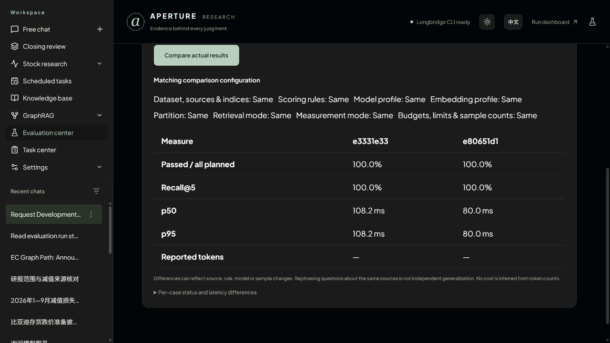

# Checkpoint 3 — remaining acceptance completed

Date: 2026-11-08. Follow-up branch: `codex/evaluation-acceptance`, based on merged PR #2. This closes evaluation-center functional acceptance in the approved GitHub release scope. It does not certify the complete PRD, financial answer quality, vision/Wiki, production SaaS security or an SLA. The [earlier snapshot](checkpoint-3-evaluations.md) and [initial delivery](github-knowledge-delivery.md) remain historical records.

## Actual browser acceptance

Runs below use retained local PostgreSQL/service records. Fixtures were synthetic QA contracts mapped through the App to uploaded public originals, not the independent frozen 24-case quality set. No PDF, database, local fixture, credential or generated answer is committed. New QA datasets were archived at the end; their versions/results remain inspectable under Archived datasets / Runs & results.

| Path | Observed result |
| --- | --- |
| Import invalid JSON, malformed cases, oversized file, retry same file | Clear errors; no renderer crash or dataset creation. TypeScript validation rejects malformed contracts before rendering; backend validates independently. |
| Legacy mapping: BYD search/select, no-match search, Commission search, change EC selection | Selections survive searches. Referenced PDF pages, total pages, issuer and publication metadata are shown. Changing a mapping resets confirmation. Page 4 against a 3-page original disables import. Search is paged; more-than-20-document UI pagination was not exercised locally. |
| Cancel mapping, reopen, confirm, import | Cancel creates nothing. Valid import creates one draft, no version/run. Development/frozen partitions and human references retained. Sources: BYD `122f6b99-dfca-46c2-b7a0-779017656c82` PDF page 2, EC definitive `a9097bbd-1564-4e24-a835-863b6563e170` page 1. |
| Publish imported rules, run, explicitly adapt supported rule, publish again | Dataset `56d5c043-f21d-4a45-b337-84f297716207`: initial run `b8aa49e6-e93d-4d02-a7d7-211e1ff27c6b` has one **unscored**, zero passes/calls. After human adaptation, `e3331e33-0ec3-472f-84a9-25f137278b00` has one configured retrieval pass. Original version/run remains unscored. Complex references are never silently scored. |
| Retry, compare matching configuration and different version | Parent-linked retry `e80651d1-233f-4858-8791-670e8bd97f60` retained one pass and zero provider calls. Matching configuration differs from the original unadapted version. Single samples are not speedup/accuracy evidence. |
| Archive cancel, archive confirm, archived filter, restore | Cancel preserves active state. Archive blocks new runs while preserving versions/history; restore enables configuration. Real-service tests also verify already queued work survives archive. |
| Actual development JSON download, inspect, reimport renamed copy | One development case exported, no frozen case. Clone `cf24e3ba-827f-4434-a0f4-f15e59934807` has zero versions/runs. Manual-rule checkbox can be checked/unchecked; cancelling edits preserves saved rules. Actual CSV download passed PR #2 acceptance. |
| Native chat startEvaluationRun, review/Escape, Decline, refresh/reopen | No evaluation created. Saved decline restores without new review/decline buttons. A second explicit request on the final build was declined: assistant acknowledges final refusal. Global run counts stayed at respective baselines (15 and 17). Chat itself uses a model; zero evaluation calls does not mean zero chat cost. |
| 500-attempt list run: Keep running, cancel again, confirm | `d92981e8-8784-46bd-8b68-df2ecf99ae75`: 343 completed passes retained, 157 cancelled, zero provider reservations. Status filters, page 2/back and rapid filter changes show current rows; empty filters have one message and retain the run summary. |
| Cancelled task timeline, Open results | Elapsed time derives from start/cancel timestamps, including old audit events without rewriting data. This run displays 37 seconds rather than zero. Link opens correct results. |
| 50-attempt run: open cancellation dialog, let finish, confirm | `cbc06465-ca91-4c52-9308-c8815066631f` stays complete, 50 passes, zero cancelled. UI explains it already ended and retained results. |
| Run details, sidebar Evaluation center | Returns to dataset home and clears evaluation-run URL parameter. |

## Controlled delayed responses

A temporary read-only loopback proxy delayed selected GETs by 4 seconds while returning real API results. It accepted no writes/model runs. The same production frontend build used a separate port; normal App/API were unchanged. Temporary listeners were stopped afterward.

- Compare e333/e806: pending state observed. Switch left to b8aa and compare. New response ended at monotonic `352443.281`; old response at `352446.968`. Afterward UI still shows b8aa/e806 and **Configuration differs**.
- Open delayed e333 details, return immediately and open e806. Current response ended at `352500.328`; delayed response at `352503.046`. URL and heading remain e806 afterward.

This establishes response order and stale-response isolation, not performance improvement or a production latency baseline.

## Checks and presentation

- Full local real-service integration: **100 tests / 72.299 s**; domain/business: **88 / 67.077 s**. These preceded the cancellation-duration follow-up; its affected workbench/evaluation/scoring suites passed **30 / 23.408 s** afterward.
- Final TypeScript/production build, native stream/lifecycle/reasoning order, Unicode evidence selection, standalone cleanup and new import/saved-decision interaction checks passed. CI repeats frontend and whole backend checks on the exact PR head before merge.
- Actual desktop 1280×720 EN/light, EN/dark, ZH/light and ZH/dark comparison views checked, including expanded case details. Above paths cover loading, empty states, modal cancellation and history. Mobile is deferred by user instruction.
- Native CopilotKit chat, tool cards, streaming and Inspector retained. Agent cannot approve its own evaluation.
- Publication preflight checked **314 tracked/new nonignored files** against **17 configured sensitive values** and common credential patterns: no matches, prohibited local artifacts or missing local Markdown links. Whitespace check passed. This is a scoped preflight, not a security audit.

Future work: independent frozen financial-quality validation, semantic judges, vision/Wiki, broad load/outage/backup drills, large-corpus UI acceptance and multi-tenant hardening. No account token balance or improvement percentage is inferred. PR/CI/main status is in the [delivery log](github-knowledge-delivery.md).
